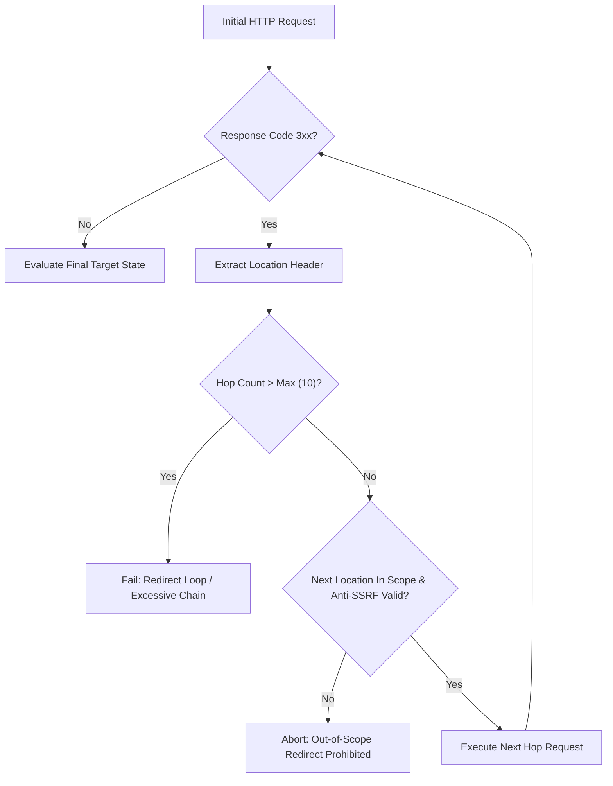

# P2-12 — Implement Safe Redirect Chain Evaluation

**Parent Epic:** [ISSUE-03: MVP Definition, Scope Bifurcation & Phase 2 Scanner Engine Execution Plan](../ISSUE-03_MVP_AND_PHASE_BIFURCATION.md)  
**Milestone:** [Phase 2 — Assessment Engine & Scanner Integrations](../MILESTONE_PHASE_2.md)  
**Workstream:** Workstream B — MVP Scanner Integrations  
**Status:** `ready-for-dev`  

---

## 🎯 Purpose

Ensure scanners handle redirects without escaping the authorized assessment scope.

---

---

## 📐 Architecture & Workflow Diagram

---

## 📋 Detailed Requirements

- Define how redirect responses are evaluated.
- Validate every redirect destination against the approved scope.
- Reject redirects to unapproved hosts, addresses, schemes, and ports.
- Enforce a maximum redirect count.
- Detect redirect loops.
- Avoid trusting scanner-reported final URLs without independent validation.
- Ensure DNS resolution and network destination checks remain consistent with Phase 1 protections.
- Record blocked redirects as structured diagnostics.

---

## 🛡️ Security & Architectural Invariants

- **Execution Isolation:** All external scanner execution must adhere strictly to ADR-0005 (Rootless OCI container workers, non-root `UID 10001`, dropped capabilities).
- **Scope Enforcement:** Scanners must never access or follow targets outside the validated scope context established in Phase 1.
- **Resource Constraints:** Timeouts, request pacing, and memory/CPU limits must be strictly applied at the worker runtime boundary.
- **Data Integrity:** Outputs must be treated as untrusted and normalized into Kelvin's Canonical Finding Schema (`finding.v1.json`, ADR-0002).

---

## ✅ Acceptance Criteria

- [ ] Each redirect destination is validated before being followed.
- [ ] Out-of-scope redirects are blocked.
- [ ] Redirect loops and excessive chains are handled safely.
- [ ] Redirect behavior is covered by automated tests.
- [ ] Blocked redirects are observable in assessment diagnostics.

---

## 🔗 Related Documentation & Links

- Architecture Baseline: [`docs/architecture/SYSTEM_ARCHITECTURE.md`](../../../docs/architecture/SYSTEM_ARCHITECTURE.md)
- Target Scope Enforcement: [`docs/architecture/TARGET_SCOPE_ENFORCEMENT.md`](../../../docs/architecture/TARGET_SCOPE_ENFORCEMENT.md)
- Worker Execution Isolation: [`docs/architecture/EXECUTION_ISOLATION.md`](../../../docs/architecture/EXECUTION_ISOLATION.md)
- Canonical Finding Schema: [`docs/architecture/FINDING_SCHEMA.md`](../../../docs/architecture/FINDING_SCHEMA.md)
- Scan Profiles Specification: [`docs/architecture/SCAN_PROFILES.md`](../../../docs/architecture/SCAN_PROFILES.md)
