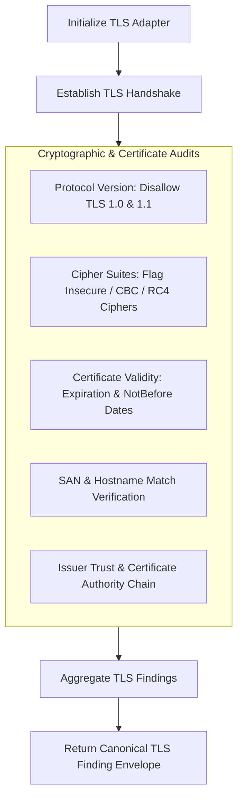

# P2-13 — Implement the TLS Configuration Assessment Adapter

**Parent Epic:** [ISSUE-03: MVP Definition, Scope Bifurcation & Phase 2 Scanner Engine Execution Plan](../ISSUE-03_MVP_AND_PHASE_BIFURCATION.md)  
**Milestone:** [Phase 2 — Assessment Engine & Scanner Integrations](../MILESTONE_PHASE_2.md)  
**Workstream:** Workstream B — MVP Scanner Integrations  
**Status:** `ready-for-dev`  

---

## 🎯 Purpose

Provide a built-in or controlled-tool adapter for evaluating the TLS configuration of approved HTTPS targets.

---

---

## 📐 Architecture & Workflow Diagram

---

## 📋 Detailed Requirements

- Define the TLS assessment implementation and its dependency strategy.
- Evaluate certificate validity and expiration.
- Capture certificate chain information where available.
- Evaluate supported TLS protocol versions.
- Identify weak or deprecated configuration according to the approved rule set.
- Record handshake and connection failures separately from security findings.
- Avoid intrusive TLS testing that could disrupt the target.
- Version the TLS assessment rules.

---

## 🛡️ Security & Architectural Invariants

- **Execution Isolation:** All external scanner execution must adhere strictly to ADR-0005 (Rootless OCI container workers, non-root `UID 10001`, dropped capabilities).
- **Scope Enforcement:** Scanners must never access or follow targets outside the validated scope context established in Phase 1.
- **Resource Constraints:** Timeouts, request pacing, and memory/CPU limits must be strictly applied at the worker runtime boundary.
- **Data Integrity:** Outputs must be treated as untrusted and normalized into Kelvin's Canonical Finding Schema (`finding.v1.json`, ADR-0002).

---

## ✅ Acceptance Criteria

- [ ] The adapter evaluates approved HTTPS targets.
- [ ] Certificate and protocol information is captured.
- [ ] Findings are returned through the common output envelope.
- [ ] Rule versions are traceable.
- [ ] Tests cover valid certificates, expired certificates, protocol issues, and connection failures.

---

## 🔗 Related Documentation & Links

- Architecture Baseline: [`docs/architecture/SYSTEM_ARCHITECTURE.md`](../../../docs/architecture/SYSTEM_ARCHITECTURE.md)
- Target Scope Enforcement: [`docs/architecture/TARGET_SCOPE_ENFORCEMENT.md`](../../../docs/architecture/TARGET_SCOPE_ENFORCEMENT.md)
- Worker Execution Isolation: [`docs/architecture/EXECUTION_ISOLATION.md`](../../../docs/architecture/EXECUTION_ISOLATION.md)
- Canonical Finding Schema: [`docs/architecture/FINDING_SCHEMA.md`](../../../docs/architecture/FINDING_SCHEMA.md)
- Scan Profiles Specification: [`docs/architecture/SCAN_PROFILES.md`](../../../docs/architecture/SCAN_PROFILES.md)
