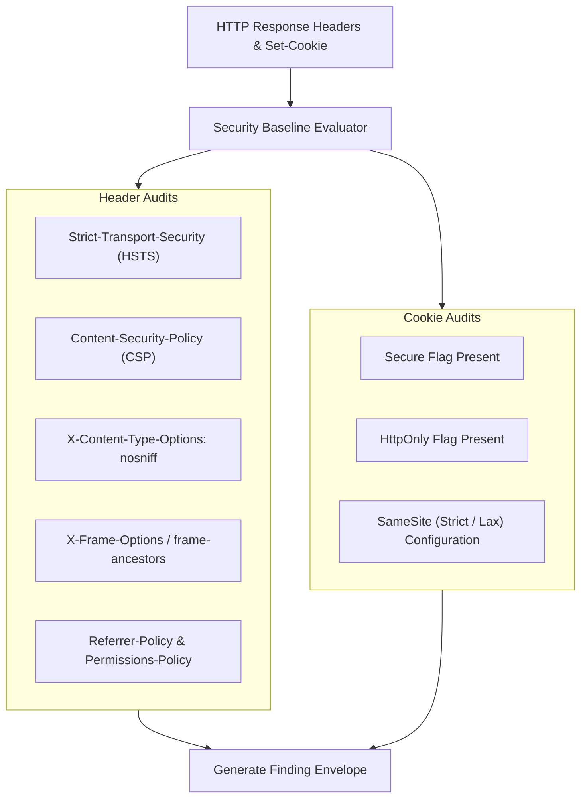

# P2-14 — Implement HTTP Security Header and Cookie Checks

**Parent Epic:** [ISSUE-03: MVP Definition, Scope Bifurcation & Phase 2 Scanner Engine Execution Plan](../ISSUE-03_MVP_AND_PHASE_BIFURCATION.md)  
**Milestone:** [Phase 2 — Assessment Engine & Scanner Integrations](../MILESTONE_PHASE_2.md)  
**Workstream:** Workstream B — MVP Scanner Integrations  
**Status:** `ready-for-dev`  

---

## 🎯 Purpose

Implement KELVIN-native checks for common HTTP security configuration weaknesses.

---

---

## 📐 Architecture & Workflow Diagram

---

## 📋 Detailed Requirements

- Inspect relevant response headers.
- Evaluate the presence and configuration of applicable security headers.
- Inspect cookie attributes such as Secure, HttpOnly, and SameSite where applicable.
- Avoid making assumptions where the response context is insufficient.
- Define detection rules and expected behavior for each check.
- Assign preliminary severity and confidence according to documented rules.
- Record the response context required to explain each result.
- Version the rules independently from scanner releases.

---

## 🛡️ Security & Architectural Invariants

- **Execution Isolation:** All external scanner execution must adhere strictly to ADR-0005 (Rootless OCI container workers, non-root `UID 10001`, dropped capabilities).
- **Scope Enforcement:** Scanners must never access or follow targets outside the validated scope context established in Phase 1.
- **Resource Constraints:** Timeouts, request pacing, and memory/CPU limits must be strictly applied at the worker runtime boundary.
- **Data Integrity:** Outputs must be treated as untrusted and normalized into Kelvin's Canonical Finding Schema (`finding.v1.json`, ADR-0002).

---

## ✅ Acceptance Criteria

- [ ] Header and cookie checks execute through a built-in adapter.
- [ ] Each rule has documented detection logic.
- [ ] Findings include evidence sufficient for later review.
- [ ] False-positive-sensitive checks have explicit confidence handling.
- [ ] Automated fixtures verify expected outcomes.

---

## 🔗 Related Documentation & Links

- Architecture Baseline: [`docs/architecture/SYSTEM_ARCHITECTURE.md`](../../../docs/architecture/SYSTEM_ARCHITECTURE.md)
- Target Scope Enforcement: [`docs/architecture/TARGET_SCOPE_ENFORCEMENT.md`](../../../docs/architecture/TARGET_SCOPE_ENFORCEMENT.md)
- Worker Execution Isolation: [`docs/architecture/EXECUTION_ISOLATION.md`](../../../docs/architecture/EXECUTION_ISOLATION.md)
- Canonical Finding Schema: [`docs/architecture/FINDING_SCHEMA.md`](../../../docs/architecture/FINDING_SCHEMA.md)
- Scan Profiles Specification: [`docs/architecture/SCAN_PROFILES.md`](../../../docs/architecture/SCAN_PROFILES.md)
