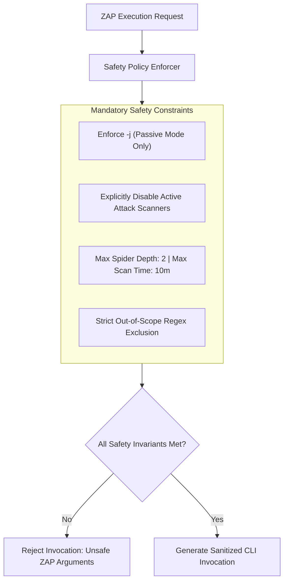

# P2-16 — Define and Enforce the ZAP Baseline Safety Profile

**Parent Epic:** [ISSUE-03: MVP Definition, Scope Bifurcation & Phase 2 Scanner Engine Execution Plan](../ISSUE-03_MVP_AND_PHASE_BIFURCATION.md)  
**Milestone:** [Phase 2 — Assessment Engine & Scanner Integrations](../MILESTONE_PHASE_2.md)  
**Workstream:** Workstream B — MVP Scanner Integrations  
**Status:** `ready-for-dev`  

---

## 🎯 Purpose

Ensure that the ZAP integration uses an approved, predictable scanning configuration suitable for the KELVIN MVP.

---

---

## 📐 Architecture & Workflow Diagram

---

## 📋 Detailed Requirements

- Define the permitted ZAP Baseline execution options.
- Explicitly prohibit switching to unrestricted active scanning through ordinary assessment configuration.
- Define request and duration limits.
- Restrict crawling behavior to approved targets.
- Ensure redirects and discovered URLs remain inside the authorized scope.
- Review default rules for operational impact.
- Document expected target traffic and potential service impact.
- Version the approved ZAP configuration.

---

## 🛡️ Security & Architectural Invariants

- **Execution Isolation:** All external scanner execution must adhere strictly to ADR-0005 (Rootless OCI container workers, non-root `UID 10001`, dropped capabilities).
- **Scope Enforcement:** Scanners must never access or follow targets outside the validated scope context established in Phase 1.
- **Resource Constraints:** Timeouts, request pacing, and memory/CPU limits must be strictly applied at the worker runtime boundary.
- **Data Integrity:** Outputs must be treated as untrusted and normalized into Kelvin's Canonical Finding Schema (`finding.v1.json`, ADR-0002).

---

## ✅ Acceptance Criteria

- [ ] A versioned ZAP Baseline profile exists.
- [ ] The adapter cannot enable unrestricted active scanning.
- [ ] Request and duration limits are enforced.
- [ ] Scope restrictions apply to discovered URLs.
- [ ] Safety behavior is tested and documented.

---

## 🔗 Related Documentation & Links

- Architecture Baseline: [`docs/architecture/SYSTEM_ARCHITECTURE.md`](../../../docs/architecture/SYSTEM_ARCHITECTURE.md)
- Target Scope Enforcement: [`docs/architecture/TARGET_SCOPE_ENFORCEMENT.md`](../../../docs/architecture/TARGET_SCOPE_ENFORCEMENT.md)
- Worker Execution Isolation: [`docs/architecture/EXECUTION_ISOLATION.md`](../../../docs/architecture/EXECUTION_ISOLATION.md)
- Canonical Finding Schema: [`docs/architecture/FINDING_SCHEMA.md`](../../../docs/architecture/FINDING_SCHEMA.md)
- Scan Profiles Specification: [`docs/architecture/SCAN_PROFILES.md`](../../../docs/architecture/SCAN_PROFILES.md)
