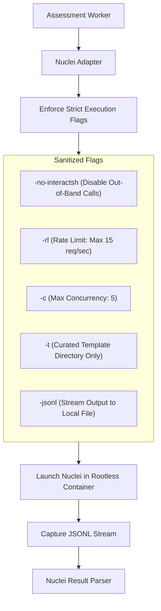

# P2-17 — Integrate Nuclei Through a Controlled Adapter

**Parent Epic:** [ISSUE-03: MVP Definition, Scope Bifurcation & Phase 2 Scanner Engine Execution Plan](../ISSUE-03_MVP_AND_PHASE_BIFURCATION.md)  
**Milestone:** [Phase 2 — Assessment Engine & Scanner Integrations](../MILESTONE_PHASE_2.md)  
**Workstream:** Workstream B — MVP Scanner Integrations  
**Status:** `ready-for-dev`  

---

## 🎯 Purpose

Integrate Nuclei as an additional scanner while preventing arbitrary or unsafe template execution.

---

---

## 📐 Architecture & Workflow Diagram

---

## 📋 Detailed Requirements

- Implement a Go adapter for the approved Nuclei runtime.
- Pass only validated targets.
- Use an approved template catalog.
- Restrict template selection to catalog identifiers.
- Record Nuclei version and template catalog version.
- Capture structured output.
- Support bounded execution time and cancellation.
- Ensure user configuration cannot inject arbitrary templates, code, or executable options.
- Handle scanner errors and partial output consistently.

---

## 🛡️ Security & Architectural Invariants

- **Execution Isolation:** All external scanner execution must adhere strictly to ADR-0005 (Rootless OCI container workers, non-root `UID 10001`, dropped capabilities).
- **Scope Enforcement:** Scanners must never access or follow targets outside the validated scope context established in Phase 1.
- **Resource Constraints:** Timeouts, request pacing, and memory/CPU limits must be strictly applied at the worker runtime boundary.
- **Data Integrity:** Outputs must be treated as untrusted and normalized into Kelvin's Canonical Finding Schema (`finding.v1.json`, ADR-0002).

---

## ✅ Acceptance Criteria

- [ ] Nuclei executes through the KELVIN worker architecture.
- [ ] Only approved templates can be selected.
- [ ] Scanner metadata is captured.
- [ ] Output follows the common envelope.
- [ ] Cancellation, timeouts, and malformed output are tested.

---

## 🔗 Related Documentation & Links

- Architecture Baseline: [`docs/architecture/SYSTEM_ARCHITECTURE.md`](../../../docs/architecture/SYSTEM_ARCHITECTURE.md)
- Target Scope Enforcement: [`docs/architecture/TARGET_SCOPE_ENFORCEMENT.md`](../../../docs/architecture/TARGET_SCOPE_ENFORCEMENT.md)
- Worker Execution Isolation: [`docs/architecture/EXECUTION_ISOLATION.md`](../../../docs/architecture/EXECUTION_ISOLATION.md)
- Canonical Finding Schema: [`docs/architecture/FINDING_SCHEMA.md`](../../../docs/architecture/FINDING_SCHEMA.md)
- Scan Profiles Specification: [`docs/architecture/SCAN_PROFILES.md`](../../../docs/architecture/SCAN_PROFILES.md)
