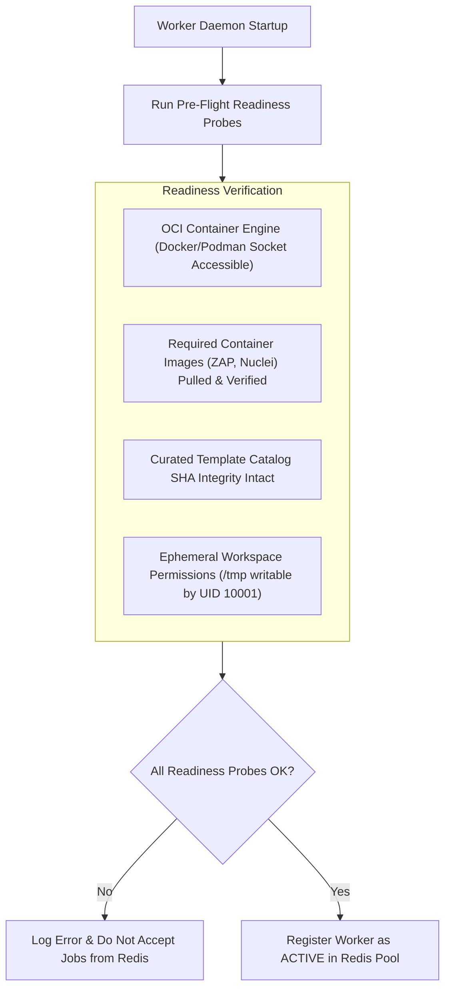

# P2-20 — Implement Scanner Availability and Runtime Readiness Checks

**Parent Epic:** [ISSUE-03: MVP Definition, Scope Bifurcation & Phase 2 Scanner Engine Execution Plan](../ISSUE-03_MVP_AND_PHASE_BIFURCATION.md)  
**Milestone:** [Phase 2 — Assessment Engine & Scanner Integrations](../MILESTONE_PHASE_2.md)  
**Workstream:** Workstream B — MVP Scanner Integrations  
**Status:** `ready-for-dev`  

---

## 🎯 Purpose

Ensure that KELVIN can determine whether each scanner is ready before attempting execution.

---

---

## 📐 Architecture & Workflow Diagram

---

## 📋 Detailed Requirements

- Verify required scanner binaries or runtime images are available.
- Verify scanner version compatibility.
- Verify required configuration and template catalogs exist.
- Detect missing or corrupted runtime dependencies.
- Expose scanner-specific readiness information through the appropriate internal health interfaces.
- Distinguish application health from individual scanner availability.
- Prevent unavailable scanners from being selected for new executions.
- Avoid exposing internal runtime details through public health endpoints.

---

## 🛡️ Security & Architectural Invariants

- **Execution Isolation:** All external scanner execution must adhere strictly to ADR-0005 (Rootless OCI container workers, non-root `UID 10001`, dropped capabilities).
- **Scope Enforcement:** Scanners must never access or follow targets outside the validated scope context established in Phase 1.
- **Resource Constraints:** Timeouts, request pacing, and memory/CPU limits must be strictly applied at the worker runtime boundary.
- **Data Integrity:** Outputs must be treated as untrusted and normalized into Kelvin's Canonical Finding Schema (`finding.v1.json`, ADR-0002).

---

## ✅ Acceptance Criteria

- [x] Scanner readiness can be evaluated independently.
- [x] Missing dependencies are detected before execution.
- [x] Unavailable scanners are reported accurately.
- [x] Readiness failures are logged with correlation information.
- [x] Tests cover missing, incompatible, and ready scanner states.

---

## 📦 Implementation Details

- **Readiness Package (`apps/worker/internal/readiness`)**:
  - Implemented `Probe` and `ProbeResult` interfaces with `Status` taxonomy (`READY`, `DEGRADED`, `UNAVAILABLE`).
  - Added system probes: `OCIEngineProbe` and `WorkspacePermissionsProbe`.
  - Added scanner probes: `ContainerImageProbe`, `TemplateCatalogProbe`, and `ScannerAdapterProbe`.
  - Implemented `Checker` coordinating independent per-scanner checks (`CheckScanner`) and system-wide evaluation (`EvaluateAll`).
  - Distinguishes overall worker process application health from individual scanner availability.
  - Implemented sanitized public HTTP endpoints (`/readyz`, `/healthz`) in `HTTPHandler` and authenticated `InternalDiagnosticsHandler`.
- **Daemon Integration (`apps/worker/internal/daemon`)**:
  - Wired `ReadinessChecker` into `daemon.Config`.
  - Added pre-flight readiness verification on daemon startup preventing job consumption if system dependencies fail.
  - Added execution guards in `process` blocking tasks for unready scanners.
- **Unit Testing**:
  - Implemented unit tests covering independent evaluation, missing dependencies, version policy mismatch, unpulled images, corrupted catalogs, workspace permissions, public sanitization, and daemon integration.
- **Architecture Documentation**:
  - [`docs/architecture/SCANNER_RUNTIME_READINESS.md`](../../../docs/architecture/SCANNER_RUNTIME_READINESS.md)

---

## 🔗 Related Documentation & Links

- Architecture Baseline: [`docs/architecture/SYSTEM_ARCHITECTURE.md`](../../../docs/architecture/SYSTEM_ARCHITECTURE.md)
- Target Scope Enforcement: [`docs/architecture/TARGET_SCOPE_ENFORCEMENT.md`](../../../docs/architecture/TARGET_SCOPE_ENFORCEMENT.md)
- Worker Execution Isolation: [`docs/architecture/EXECUTION_ISOLATION.md`](../../../docs/architecture/EXECUTION_ISOLATION.md)
- Canonical Finding Schema: [`docs/architecture/FINDING_SCHEMA.md`](../../../docs/architecture/FINDING_SCHEMA.md)
- Scan Profiles Specification: [`docs/architecture/SCAN_PROFILES.md`](../../../docs/architecture/SCAN_PROFILES.md)
- Scanner Runtime Readiness: [`docs/architecture/SCANNER_RUNTIME_READINESS.md`](../../../docs/architecture/SCANNER_RUNTIME_READINESS.md)
