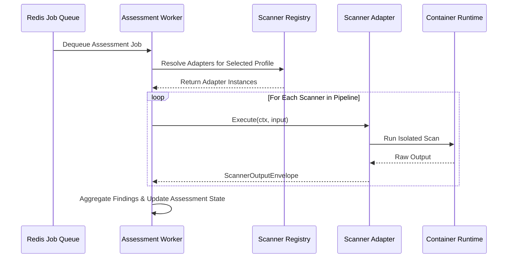

# P2-21 — Integrate Scanner Adapters with the Assessment Worker

**Parent Epic:** [ISSUE-03: MVP Definition, Scope Bifurcation & Phase 2 Scanner Engine Execution Plan](../ISSUE-03_MVP_AND_PHASE_BIFURCATION.md)  
**Milestone:** [Phase 2 — Assessment Engine & Scanner Integrations](../MILESTONE_PHASE_2.md)  
**Workstream:** Workstream C — Worker Execution & Orchestration  
**Status:** `ready-for-dev`  

---

## 🎯 Purpose

Connect the Phase 1 assessment worker and queue foundations to the scanner adapter system.

---

---

## 📐 Architecture & Workflow Diagram

---

## 📋 Detailed Requirements

- Resolve scanner adapters from the registry.
- Load the validated assessment execution context.
- Execute the scanners selected by the assessment profile.
- Use existing Phase 1 job lifecycle and queue contracts.
- Keep worker orchestration separate from scanner-specific logic.
- Ensure failures are reported through the established lifecycle.
- Preserve assessment and tenant context throughout execution.
- Prevent workers from accepting unvalidated execution requests.

---

## 🛡️ Security & Architectural Invariants

- **Execution Isolation:** All external scanner execution must adhere strictly to ADR-0005 (Rootless OCI container workers, non-root `UID 10001`, dropped capabilities).
- **Scope Enforcement:** Scanners must never access or follow targets outside the validated scope context established in Phase 1.
- **Resource Constraints:** Timeouts, request pacing, and memory/CPU limits must be strictly applied at the worker runtime boundary.
- **Data Integrity:** Outputs must be treated as untrusted and normalized into Kelvin's Canonical Finding Schema (`finding.v1.json`, ADR-0002).

---

## ✅ Acceptance Criteria

- [x] Assessment jobs can trigger registered scanner adapters.
- [x] Existing Phase 1 lifecycle semantics are preserved.
- [x] Worker execution is independent of scanner implementation details.
- [x] Failures are reflected in the established job state model.
- [x] Integration tests cover complete worker execution.

---

## 📦 Implementation Details

- **Worker Orchestration Engine (`apps/worker/internal/daemon/orchestrator.go`)**:
  - Implemented `Orchestrator` to decouple worker queue lifecycle from scanner-specific mechanics.
  - Supports dual execution modes:
    - In-process adapters (`RequiresSandbox: false`, e.g. `http_preflight`, `tls_assessor`, `http_security_headers`) run directly with bounded timeouts and network egress policies.
    - Containerized adapters (`RequiresSandbox: true`, e.g. `zap`, `nuclei`) run in rootless OCI sandboxes (ADR-0005) with output normalization (`NormalizeZAPReport`, `NormalizeNucleiReport`).
  - Added assessment pipeline orchestration (`ExecutePipeline`) executing multi-phase profile workflows (`profile.DefaultScannerOrder`), evaluating prerequisite dependencies (`RequirePrev`), and aggregating findings.
- **Worker Daemon Integration (`apps/worker/internal/daemon/daemon.go`)**:
  - Dispatches both assessment pipeline jobs (`JobTypeAssessment`) and individual scanner jobs.
  - Enforces fail-closed profile validation (`ValidateProfileSelection`) preventing unauthorized scanner executions.
  - Preserves tenant UUID, assessment UUID, job UUID, and correlation tracking.
- **Integration Test Suite (`apps/worker/internal/daemon/orchestrator_test.go`)**:
  - Covered in-process adapter execution, unapproved profile scanner rejection, full multi-phase assessment pipeline execution, and prerequisite phase dependency failure handling.
- **Architecture Documentation**:
  - [`docs/architecture/ASSESSMENT_WORKER_ADAPTER_INTEGRATION.md`](../../../docs/architecture/ASSESSMENT_WORKER_ADAPTER_INTEGRATION.md)

---

## 🔗 Related Documentation & Links

- Architecture Baseline: [`docs/architecture/SYSTEM_ARCHITECTURE.md`](../../../docs/architecture/SYSTEM_ARCHITECTURE.md)
- Target Scope Enforcement: [`docs/architecture/TARGET_SCOPE_ENFORCEMENT.md`](../../../docs/architecture/TARGET_SCOPE_ENFORCEMENT.md)
- Worker Execution Isolation: [`docs/architecture/EXECUTION_ISOLATION.md`](../../../docs/architecture/EXECUTION_ISOLATION.md)
- Canonical Finding Schema: [`docs/architecture/FINDING_SCHEMA.md`](../../../docs/architecture/FINDING_SCHEMA.md)
- Scan Profiles Specification: [`docs/architecture/SCAN_PROFILES.md`](../../../docs/architecture/SCAN_PROFILES.md)
- Worker Adapter Integration: [`docs/architecture/ASSESSMENT_WORKER_ADAPTER_INTEGRATION.md`](../../../docs/architecture/ASSESSMENT_WORKER_ADAPTER_INTEGRATION.md)
