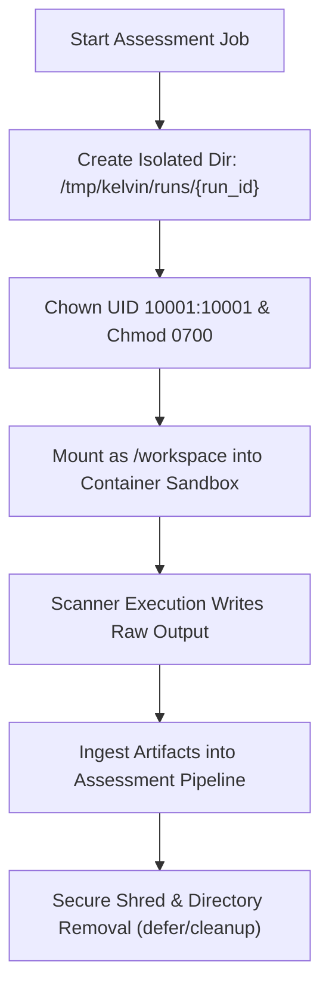

# P2-22 — Implement Per-Assessment Workspace Management

**Parent Epic:** [ISSUE-03: MVP Definition, Scope Bifurcation & Phase 2 Scanner Engine Execution Plan](../ISSUE-03_MVP_AND_PHASE_BIFURCATION.md)  
**Milestone:** [Phase 2 — Assessment Engine & Scanner Integrations](../MILESTONE_PHASE_2.md)  
**Workstream:** Workstream C — Worker Execution & Orchestration  
**Status:** `ready-for-dev`  

---

## 🎯 Purpose

Provide isolated temporary storage for scanner configuration, intermediate data, and execution output.

---

---

## 📐 Architecture & Workflow Diagram

---

## 📋 Detailed Requirements

- Create a dedicated workspace for each assessment execution.
- Ensure workspaces cannot be accessed by unrelated assessments or tenants.
- Define safe locations for configuration, temporary files, and output.
- Use unique execution identifiers for workspace paths.
- Prevent path traversal through user-controlled filenames.
- Define workspace ownership and permission rules.
- Ensure interrupted executions do not leave uncontrolled temporary data.
- Integrate cleanup with the existing job recovery and evidence lifecycle design.

---

## 🛡️ Security & Architectural Invariants

- **Execution Isolation:** All external scanner execution must adhere strictly to ADR-0005 (Rootless OCI container workers, non-root `UID 10001`, dropped capabilities).
- **Scope Enforcement:** Scanners must never access or follow targets outside the validated scope context established in Phase 1.
- **Resource Constraints:** Timeouts, request pacing, and memory/CPU limits must be strictly applied at the worker runtime boundary.
- **Data Integrity:** Outputs must be treated as untrusted and normalized into Kelvin's Canonical Finding Schema (`finding.v1.json`, ADR-0002).

---

## ✅ Acceptance Criteria

- [x] Each execution receives an isolated workspace.
- [x] Cross-assessment access is prevented.
- [x] Temporary files use controlled paths and permissions.
- [x] Workspaces are cleaned up according to policy.
- [x] Cleanup behavior is tested under success, failure, and cancellation.

---

## 📦 Implementation Details

- **Workspace Management Package (`apps/worker/internal/workspace`)**:
  - Implemented `Manager` and `Workspace` providing partitioned layouts: `{base_dir}/tenants/{tenant_id}/runs/{run_id}/{config,tmp,output}`.
  - Implemented fail-closed path traversal validation in `ResolveSafePath`, rejecting control characters, null bytes, absolute paths, and parent directory escapes.
  - Enforced strict permissions: `0700` (`rwx------`) on directories and `0600` (`rw-------`) on files, compatible with non-root `UID 10001` (ADR-0005).
  - Implemented automated and idempotent `Cleanup` for stack unwinding, plus `ReapStale` for sweeping orphaned run directories from interrupted executions.
- **Sandbox & Daemon Integration**:
  - Extended `sandbox.Spec` and `OCIExecutor` to support `WorkspaceMount` bind-mounted to `/workspace:rw` with `--workdir /workspace`.
  - Added `KELVIN_WORKSPACE=/workspace` to container execution environment.
  - Wired workspace creation and deferred cleanup into `Orchestrator.ExecuteScanner`.
- **Unit & Integration Test Coverage (`apps/worker/internal/workspace/workspace_test.go`)**:
  - Covered workspace creation, directory layout, cross-tenant isolation, path traversal rejection, safe file I/O, cleanup idempotence, and stale directory reaping.
- **Architecture Documentation**:
  - [`docs/architecture/PER_ASSESSMENT_WORKSPACE_MANAGEMENT.md`](../../../docs/architecture/PER_ASSESSMENT_WORKSPACE_MANAGEMENT.md)

---

## 🔗 Related Documentation & Links

- Architecture Baseline: [`docs/architecture/SYSTEM_ARCHITECTURE.md`](../../../docs/architecture/SYSTEM_ARCHITECTURE.md)
- Target Scope Enforcement: [`docs/architecture/TARGET_SCOPE_ENFORCEMENT.md`](../../../docs/architecture/TARGET_SCOPE_ENFORCEMENT.md)
- Worker Execution Isolation: [`docs/architecture/EXECUTION_ISOLATION.md`](../../../docs/architecture/EXECUTION_ISOLATION.md)
- Canonical Finding Schema: [`docs/architecture/FINDING_SCHEMA.md`](../../../docs/architecture/FINDING_SCHEMA.md)
- Scan Profiles Specification: [`docs/architecture/SCAN_PROFILES.md`](../../../docs/architecture/SCAN_PROFILES.md)
- Workspace Management: [`docs/architecture/PER_ASSESSMENT_WORKSPACE_MANAGEMENT.md`](../../../docs/architecture/PER_ASSESSMENT_WORKSPACE_MANAGEMENT.md)
