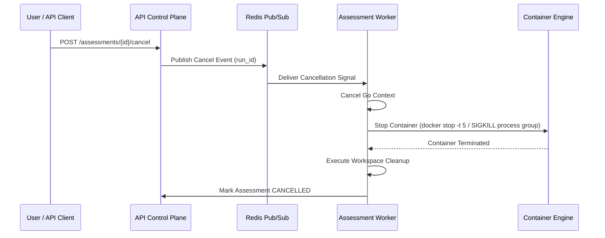

# P2-26 — Implement Full Scanner Process Cancellation

**Parent Epic:** [ISSUE-03: MVP Definition, Scope Bifurcation & Phase 2 Scanner Engine Execution Plan](../ISSUE-03_MVP_AND_PHASE_BIFURCATION.md)  
**Milestone:** [Phase 2 — Assessment Engine & Scanner Integrations](../MILESTONE_PHASE_2.md)  
**Workstream:** Workstream C — Worker Execution & Orchestration  
**Status:** `ready-for-dev`  

---

## 🎯 Purpose

Ensure cancelling an assessment terminates the associated scanner process and its child processes.

---

---

## 📐 Architecture & Workflow Diagram

---

## 📋 Detailed Requirements

- Connect existing Phase 1 cancellation semantics to scanner execution.
- Propagate cancellation signals to active adapters.
- Terminate the full process tree or isolated execution container as appropriate.
- Prevent orphaned subprocesses.
- Stop collecting new scanner output after cancellation.
- Preserve already collected valid diagnostics.
- Distinguish user cancellation from timeout and infrastructure termination.
- Ensure cancellation is safe when requested repeatedly.

---

## 🛡️ Security & Architectural Invariants

- **Execution Isolation:** All external scanner execution must adhere strictly to ADR-0005 (Rootless OCI container workers, non-root `UID 10001`, dropped capabilities).
- **Scope Enforcement:** Scanners must never access or follow targets outside the validated scope context established in Phase 1.
- **Resource Constraints:** Timeouts, request pacing, and memory/CPU limits must be strictly applied at the worker runtime boundary.
- **Data Integrity:** Outputs must be treated as untrusted and normalized into Kelvin's Canonical Finding Schema (`finding.v1.json`, ADR-0002).

---

## ✅ Acceptance Criteria

- [ ] Cancelling an assessment stops associated scanner execution.
- [ ] Child processes are terminated.
- [ ] Repeated cancellation requests are handled safely.
- [ ] Final execution state accurately reflects cancellation.
- [ ] Automated tests verify cleanup and absence of orphan processes.

---

## 🔗 Related Documentation & Links

- Architecture Baseline: [`docs/architecture/SYSTEM_ARCHITECTURE.md`](../../../docs/architecture/SYSTEM_ARCHITECTURE.md)
- Target Scope Enforcement: [`docs/architecture/TARGET_SCOPE_ENFORCEMENT.md`](../../../docs/architecture/TARGET_SCOPE_ENFORCEMENT.md)
- Worker Execution Isolation: [`docs/architecture/EXECUTION_ISOLATION.md`](../../../docs/architecture/EXECUTION_ISOLATION.md)
- Canonical Finding Schema: [`docs/architecture/FINDING_SCHEMA.md`](../../../docs/architecture/FINDING_SCHEMA.md)
- Scan Profiles Specification: [`docs/architecture/SCAN_PROFILES.md`](../../../docs/architecture/SCAN_PROFILES.md)
