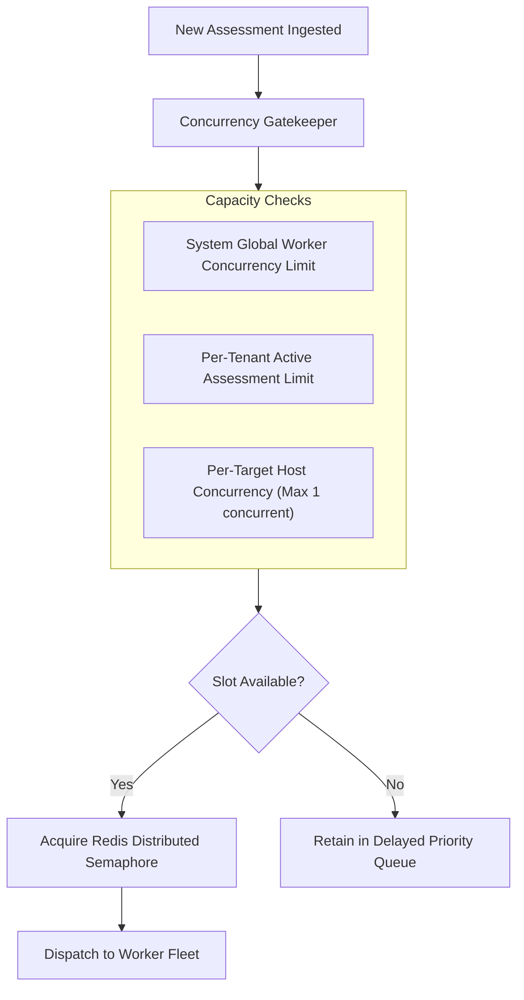

# P2-28 — Implement Assessment Concurrency Controls

**Parent Epic:** [ISSUE-03: MVP Definition, Scope Bifurcation & Phase 2 Scanner Engine Execution Plan](../ISSUE-03_MVP_AND_PHASE_BIFURCATION.md)  
**Milestone:** [Phase 2 — Assessment Engine & Scanner Integrations](../MILESTONE_PHASE_2.md)  
**Workstream:** Workstream C — Worker Execution & Orchestration  
**Status:** `ready-for-dev`  

---

## 🎯 Purpose

Prevent uncontrolled simultaneous scanner execution from exhausting platform resources or overwhelming targets.

---

---

## 📐 Architecture & Workflow Diagram

---

## 📋 Detailed Requirements

- Define global concurrency limits.
- Define per-tenant concurrency limits.
- Define scanner-specific concurrency limits.
- Integrate concurrency controls with the existing queue architecture.
- Handle queued work when capacity is unavailable.
- Prevent race conditions when acquiring and releasing execution capacity.
- Ensure crashed workers do not permanently consume concurrency slots.
- Define observable capacity and saturation metrics.

---

## 🛡️ Security & Architectural Invariants

- **Execution Isolation:** All external scanner execution must adhere strictly to ADR-0005 (Rootless OCI container workers, non-root `UID 10001`, dropped capabilities).
- **Scope Enforcement:** Scanners must never access or follow targets outside the validated scope context established in Phase 1.
- **Resource Constraints:** Timeouts, request pacing, and memory/CPU limits must be strictly applied at the worker runtime boundary.
- **Data Integrity:** Outputs must be treated as untrusted and normalized into Kelvin's Canonical Finding Schema (`finding.v1.json`, ADR-0002).

---

## ✅ Acceptance Criteria

- [ ] Global and per-tenant concurrency limits are enforced.
- [ ] Scanner-specific caps are respected.
- [ ] Capacity is released after success, failure, timeout, or worker recovery.
- [ ] Concurrent execution tests pass.
- [ ] Queue saturation is observable.

---

## 🔗 Related Documentation & Links

- Architecture Baseline: [`docs/architecture/SYSTEM_ARCHITECTURE.md`](../../../docs/architecture/SYSTEM_ARCHITECTURE.md)
- Target Scope Enforcement: [`docs/architecture/TARGET_SCOPE_ENFORCEMENT.md`](../../../docs/architecture/TARGET_SCOPE_ENFORCEMENT.md)
- Worker Execution Isolation: [`docs/architecture/EXECUTION_ISOLATION.md`](../../../docs/architecture/EXECUTION_ISOLATION.md)
- Canonical Finding Schema: [`docs/architecture/FINDING_SCHEMA.md`](../../../docs/architecture/FINDING_SCHEMA.md)
- Scan Profiles Specification: [`docs/architecture/SCAN_PROFILES.md`](../../../docs/architecture/SCAN_PROFILES.md)
