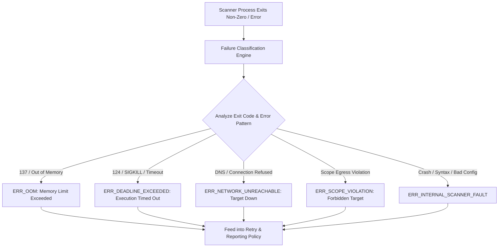

# P2-30 — Define Scanner Failure Classification

**Parent Epic:** [ISSUE-03: MVP Definition, Scope Bifurcation & Phase 2 Scanner Engine Execution Plan](../ISSUE-03_MVP_AND_PHASE_BIFURCATION.md)  
**Milestone:** [Phase 2 — Assessment Engine & Scanner Integrations](../MILESTONE_PHASE_2.md)  
**Workstream:** Workstream C — Worker Execution & Orchestration  
**Status:** `ready-for-dev`  

---

## 🎯 Purpose

Create consistent failure categories so the assessment engine can distinguish scanner problems from target and infrastructure problems.

---

---

## 📐 Architecture & Workflow Diagram

---

## 📋 Detailed Requirements

- Define standard failure categories, including: Invalid scanner configuration, Unsupported scanner version, Target connection failure, Scope restriction failure, Scanner process failure, Scanner timeout, Resource exhaustion, Output parsing failure, Worker infrastructure failure.
- Map scanner-specific exit codes and error messages into standard categories.
- Avoid relying entirely on free-text error messages.
- Define which failures are terminal and which may be retryable.
- Ensure diagnostic details do not leak secrets.

---

## 🛡️ Security & Architectural Invariants

- **Execution Isolation:** All external scanner execution must adhere strictly to ADR-0005 (Rootless OCI container workers, non-root `UID 10001`, dropped capabilities).
- **Scope Enforcement:** Scanners must never access or follow targets outside the validated scope context established in Phase 1.
- **Resource Constraints:** Timeouts, request pacing, and memory/CPU limits must be strictly applied at the worker runtime boundary.
- **Data Integrity:** Outputs must be treated as untrusted and normalized into Kelvin's Canonical Finding Schema (`finding.v1.json`, ADR-0002).

---

## ✅ Acceptance Criteria

- [ ] A common scanner failure taxonomy exists.
- [ ] Each integrated scanner maps known failures into it.
- [ ] Unknown failures are represented safely.
- [ ] Failure categories are available to orchestration logic.
- [ ] Tests verify representative failure mappings.

---

## 🔗 Related Documentation & Links

- Architecture Baseline: [`docs/architecture/SYSTEM_ARCHITECTURE.md`](../../../docs/architecture/SYSTEM_ARCHITECTURE.md)
- Target Scope Enforcement: [`docs/architecture/TARGET_SCOPE_ENFORCEMENT.md`](../../../docs/architecture/TARGET_SCOPE_ENFORCEMENT.md)
- Worker Execution Isolation: [`docs/architecture/EXECUTION_ISOLATION.md`](../../../docs/architecture/EXECUTION_ISOLATION.md)
- Canonical Finding Schema: [`docs/architecture/FINDING_SCHEMA.md`](../../../docs/architecture/FINDING_SCHEMA.md)
- Scan Profiles Specification: [`docs/architecture/SCAN_PROFILES.md`](../../../docs/architecture/SCAN_PROFILES.md)
