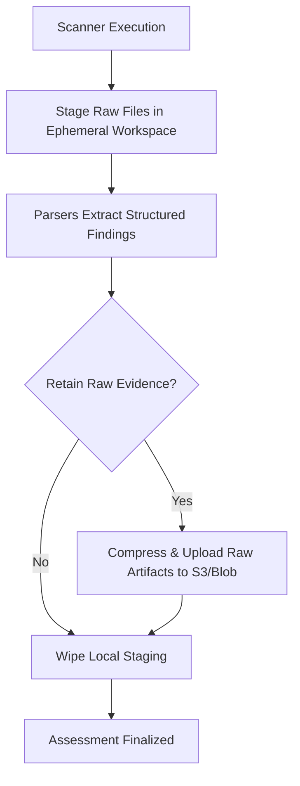

# P2-34 — Implement Raw Scanner Output Staging and Cleanup

**Parent Epic:** [ISSUE-03: MVP Definition, Scope Bifurcation & Phase 2 Scanner Engine Execution Plan](../ISSUE-03_MVP_AND_PHASE_BIFURCATION.md)  
**Milestone:** [Phase 2 — Assessment Engine & Scanner Integrations](../MILESTONE_PHASE_2.md)  
**Workstream:** Workstream C — Worker Execution & Orchestration  
**Status:** `ready-for-dev`  

---

## 🎯 Purpose

Manage raw scanner output before it is validated and normalized.

---

---

## 📐 Architecture & Workflow Diagram

---

## 📋 Detailed Requirements

- Define where raw output is temporarily stored.
- Use assessment-specific workspace boundaries.
- Ensure raw output is not exposed as trusted finding data.
- Integrate retention and cleanup with the Phase 1 evidence lifecycle policy.
- Prevent one tenant from accessing another tenant's raw output.
- Handle incomplete output after crashes and cancellation.
- Record cleanup failures for operational review.
- Avoid retaining unnecessary duplicate copies of sensitive output.

---

## 🛡️ Security & Architectural Invariants

- **Execution Isolation:** All external scanner execution must adhere strictly to ADR-0005 (Rootless OCI container workers, non-root `UID 10001`, dropped capabilities).
- **Scope Enforcement:** Scanners must never access or follow targets outside the validated scope context established in Phase 1.
- **Resource Constraints:** Timeouts, request pacing, and memory/CPU limits must be strictly applied at the worker runtime boundary.
- **Data Integrity:** Outputs must be treated as untrusted and normalized into Kelvin's Canonical Finding Schema (`finding.v1.json`, ADR-0002).

---

## ✅ Acceptance Criteria

- [ ] Raw scanner output has a controlled storage lifecycle.
- [ ] Temporary output is isolated by assessment.
- [ ] Cleanup follows approved retention rules.
- [ ] Failed cleanup is observable.
- [ ] Tests cover normal cleanup and interrupted execution.

---

## 🔗 Related Documentation & Links

- Architecture Baseline: [`docs/architecture/SYSTEM_ARCHITECTURE.md`](../../../docs/architecture/SYSTEM_ARCHITECTURE.md)
- Target Scope Enforcement: [`docs/architecture/TARGET_SCOPE_ENFORCEMENT.md`](../../../docs/architecture/TARGET_SCOPE_ENFORCEMENT.md)
- Worker Execution Isolation: [`docs/architecture/EXECUTION_ISOLATION.md`](../../../docs/architecture/EXECUTION_ISOLATION.md)
- Canonical Finding Schema: [`docs/architecture/FINDING_SCHEMA.md`](../../../docs/architecture/FINDING_SCHEMA.md)
- Scan Profiles Specification: [`docs/architecture/SCAN_PROFILES.md`](../../../docs/architecture/SCAN_PROFILES.md)
