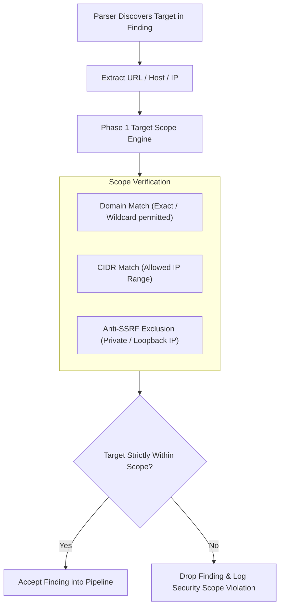

# P2-37 — Validate Scanner-Reported Targets Against Assessment Scope

**Parent Epic:** [ISSUE-03: MVP Definition, Scope Bifurcation & Phase 2 Scanner Engine Execution Plan](../ISSUE-03_MVP_AND_PHASE_BIFURCATION.md)  
**Milestone:** [Phase 2 — Assessment Engine & Scanner Integrations](../MILESTONE_PHASE_2.md)  
**Workstream:** Workstream C — Worker Execution & Orchestration  
**Status:** `ready-for-dev`  

---

## 🎯 Purpose

Ensure that output from scanners cannot introduce findings or follow-up targets outside the approved assessment scope.

---

---

## 📐 Architecture & Workflow Diagram

---

## 📋 Detailed Requirements

- Validate hostnames, URLs, ports, and other target references reported by scanners.
- Reuse the Phase 1 canonical target and scope validation rules.
- Reject or quarantine results that reference unauthorized targets.
- Do not automatically launch follow-up scans based on scanner output.
- Record rejected references as structured diagnostics.
- Ensure parser implementations cannot bypass scope enforcement.
- Define how findings referring to third-party resources are represented.

---

## 🛡️ Security & Architectural Invariants

- **Execution Isolation:** All external scanner execution must adhere strictly to ADR-0005 (Rootless OCI container workers, non-root `UID 10001`, dropped capabilities).
- **Scope Enforcement:** Scanners must never access or follow targets outside the validated scope context established in Phase 1.
- **Resource Constraints:** Timeouts, request pacing, and memory/CPU limits must be strictly applied at the worker runtime boundary.
- **Data Integrity:** Outputs must be treated as untrusted and normalized into Kelvin's Canonical Finding Schema (`finding.v1.json`, ADR-0002).

---

## ✅ Acceptance Criteria

- [ ] Scanner-reported targets are independently validated.
- [ ] Out-of-scope references cannot trigger additional scanning.
- [ ] Unauthorized target references are handled consistently.
- [ ] Rejections are traceable.
- [ ] Automated tests cover out-of-scope scanner output.

---

## 🔗 Related Documentation & Links

- Architecture Baseline: [`docs/architecture/SYSTEM_ARCHITECTURE.md`](../../../docs/architecture/SYSTEM_ARCHITECTURE.md)
- Target Scope Enforcement: [`docs/architecture/TARGET_SCOPE_ENFORCEMENT.md`](../../../docs/architecture/TARGET_SCOPE_ENFORCEMENT.md)
- Worker Execution Isolation: [`docs/architecture/EXECUTION_ISOLATION.md`](../../../docs/architecture/EXECUTION_ISOLATION.md)
- Canonical Finding Schema: [`docs/architecture/FINDING_SCHEMA.md`](../../../docs/architecture/FINDING_SCHEMA.md)
- Scan Profiles Specification: [`docs/architecture/SCAN_PROFILES.md`](../../../docs/architecture/SCAN_PROFILES.md)
