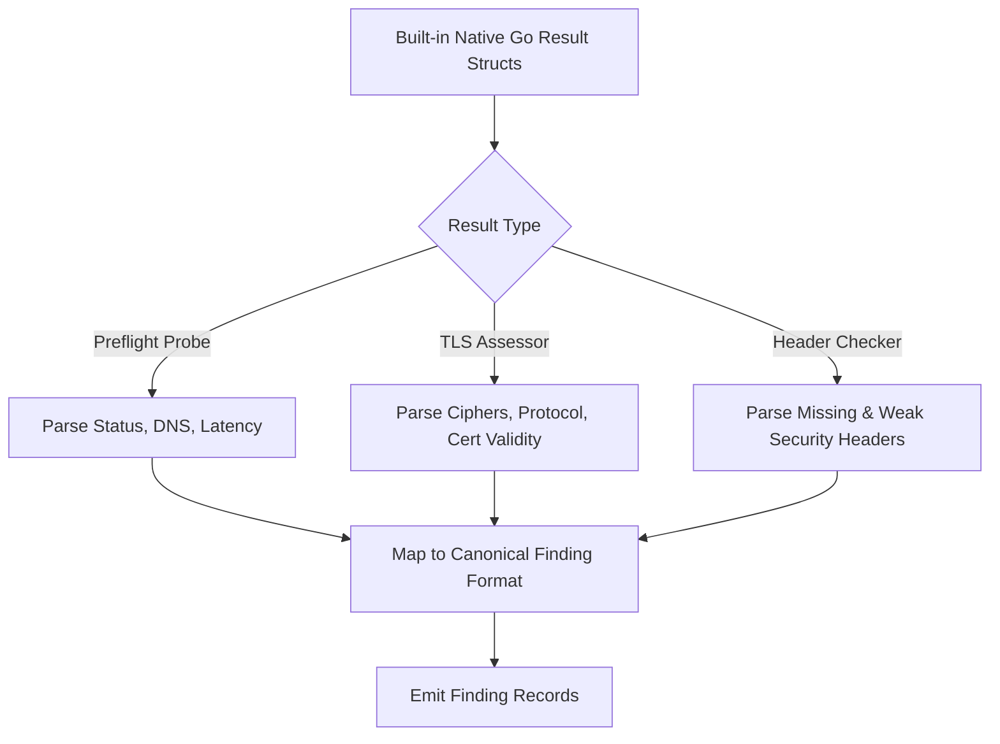

# P2-41 — Implement Built-In HTTP and TLS Result Parsers

**Parent Epic:** [ISSUE-03: MVP Definition, Scope Bifurcation & Phase 2 Scanner Engine Execution Plan](../ISSUE-03_MVP_AND_PHASE_BIFURCATION.md)  
**Milestone:** [Phase 2 — Assessment Engine & Scanner Integrations](../MILESTONE_PHASE_2.md)  
**Workstream:** Workstream D — Result Parsing & Normalization  
**Status:** `ready-for-dev`  

---

## 🎯 Purpose

Normalize the structured output generated by KELVIN's built-in HTTP, cookie, header, and TLS checks.

---

---

## 📐 Architecture & Workflow Diagram

---

## 📋 Detailed Requirements

- Define parsing logic for each built-in assessment adapter.
- Convert individual check outcomes into the common scanner result representation.
- Preserve the specific rule identifier and version.
- Capture relevant response or certificate evidence.
- Distinguish a confirmed configuration issue from an inconclusive check.
- Handle unavailable or incomplete target responses.
- Ensure outputs follow the same validation rules as external scanner results.

---

## 🛡️ Security & Architectural Invariants

- **Execution Isolation:** All external scanner execution must adhere strictly to ADR-0005 (Rootless OCI container workers, non-root `UID 10001`, dropped capabilities).
- **Scope Enforcement:** Scanners must never access or follow targets outside the validated scope context established in Phase 1.
- **Resource Constraints:** Timeouts, request pacing, and memory/CPU limits must be strictly applied at the worker runtime boundary.
- **Data Integrity:** Outputs must be treated as untrusted and normalized into Kelvin's Canonical Finding Schema (`finding.v1.json`, ADR-0002).

---

## ✅ Acceptance Criteria

- [ ] Built-in check results use the common result representation.
- [ ] Rule identifiers and versions are preserved.
- [ ] Inconclusive checks are not represented as confirmed findings.
- [ ] Evidence fields are validated.
- [ ] Automated tests cover each built-in rule family.

---

## 🔗 Related Documentation & Links

- Architecture Baseline: [`docs/architecture/SYSTEM_ARCHITECTURE.md`](../../../docs/architecture/SYSTEM_ARCHITECTURE.md)
- Target Scope Enforcement: [`docs/architecture/TARGET_SCOPE_ENFORCEMENT.md`](../../../docs/architecture/TARGET_SCOPE_ENFORCEMENT.md)
- Worker Execution Isolation: [`docs/architecture/EXECUTION_ISOLATION.md`](../../../docs/architecture/EXECUTION_ISOLATION.md)
- Canonical Finding Schema: [`docs/architecture/FINDING_SCHEMA.md`](../../../docs/architecture/FINDING_SCHEMA.md)
- Scan Profiles Specification: [`docs/architecture/SCAN_PROFILES.md`](../../../docs/architecture/SCAN_PROFILES.md)
