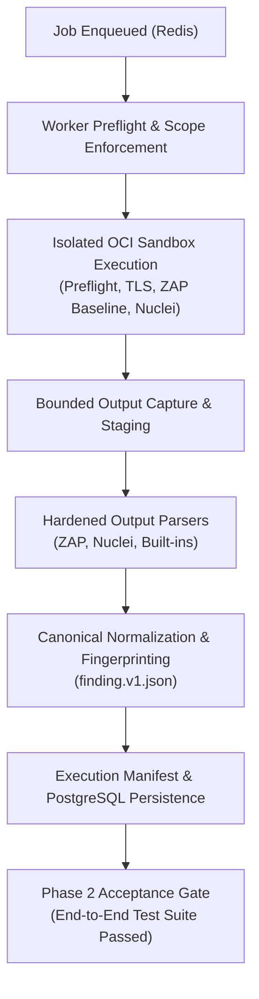

# P2-45 — Complete Phase 2 End-to-End Assessment Pipeline and Readiness Review

**Parent Epic:** [ISSUE-03: MVP Definition, Scope Bifurcation & Phase 2 Scanner Engine Execution Plan](../ISSUE-03_MVP_AND_PHASE_BIFURCATION.md)  
**Milestone:** [Phase 2 — Assessment Engine & Scanner Integrations](../MILESTONE_PHASE_2.md)  
**Workstream:** Workstream E — Integration Testing & Phase 2 Completion  
**Status:** `ready-for-dev`  

---

## 🎯 Purpose

Verify that KELVIN can execute a complete, authorized, bounded assessment through its integrated scanner pipeline and deliver normalized results reliably.

---

---

## 📐 Architecture & Workflow Diagram

---

## 📋 Detailed Requirements

- End-to-End Workflow: Submit assessment with valid Phase 1 profile -> Validate target & scope -> Queue and dispatch via worker -> Execute selected scanner adapters -> Capture progress & diagnostics -> Collect raw output -> Parse and validate scanner results -> Normalize into canonical finding schema -> Persist/hand off accepted results through Phase 1 persistence boundaries.
- Security Verification: Verify out-of-scope targets rejected -> Verify redirects cannot escape scope -> Verify scanner runtimes cannot bypass worker restrictions -> Verify resource, rate, and time limits -> Verify cancellation stops scanner processes -> Verify malicious/malformed output handled safely -> Verify repeated queue delivery prevents duplicate execution.
- Reliability Verification: Test scanner unavailable scenarios -> Test scanner timeout and crash scenarios -> Test partial assessment completion -> Test retry behavior -> Test cleanup after success, failure, cancellation -> Test recovery after worker interruption.
- Documentation: Document supported scanners and versions -> Document MVP assessment profiles and limits -> Document scanner execution and failure semantics -> Document test coverage and known limitations -> Record remaining technical debt and deferred capabilities.

---

## 🛡️ Security & Architectural Invariants

- **Execution Isolation:** All external scanner execution must adhere strictly to ADR-0005 (Rootless OCI container workers, non-root `UID 10001`, dropped capabilities).
- **Scope Enforcement:** Scanners must never access or follow targets outside the validated scope context established in Phase 1.
- **Resource Constraints:** Timeouts, request pacing, and memory/CPU limits must be strictly applied at the worker runtime boundary.
- **Data Integrity:** Outputs must be treated as untrusted and normalized into Kelvin's Canonical Finding Schema (`finding.v1.json`, ADR-0002).

---

## ✅ Acceptance Criteria

- [ ] A complete assessment executes successfully in an isolated test environment.
- [ ] All selected MVP scanner integrations pass their adapter tests.
- [ ] Results are normalized against the Phase 1 canonical schema.
- [ ] Security and scope enforcement tests pass.
- [ ] Cancellation, timeout, retry, and partial completion behavior is verified.
- [ ] No critical Phase 2 integration defects remain unresolved.
- [ ] Supported scanner versions and limitations are documented.
- [ ] A Phase 2 readiness report is approved.

---

## 🔗 Related Documentation & Links

- Architecture Baseline: [`docs/architecture/SYSTEM_ARCHITECTURE.md`](../../../docs/architecture/SYSTEM_ARCHITECTURE.md)
- Target Scope Enforcement: [`docs/architecture/TARGET_SCOPE_ENFORCEMENT.md`](../../../docs/architecture/TARGET_SCOPE_ENFORCEMENT.md)
- Worker Execution Isolation: [`docs/architecture/EXECUTION_ISOLATION.md`](../../../docs/architecture/EXECUTION_ISOLATION.md)
- Canonical Finding Schema: [`docs/architecture/FINDING_SCHEMA.md`](../../../docs/architecture/FINDING_SCHEMA.md)
- Scan Profiles Specification: [`docs/architecture/SCAN_PROFILES.md`](../../../docs/architecture/SCAN_PROFILES.md)
