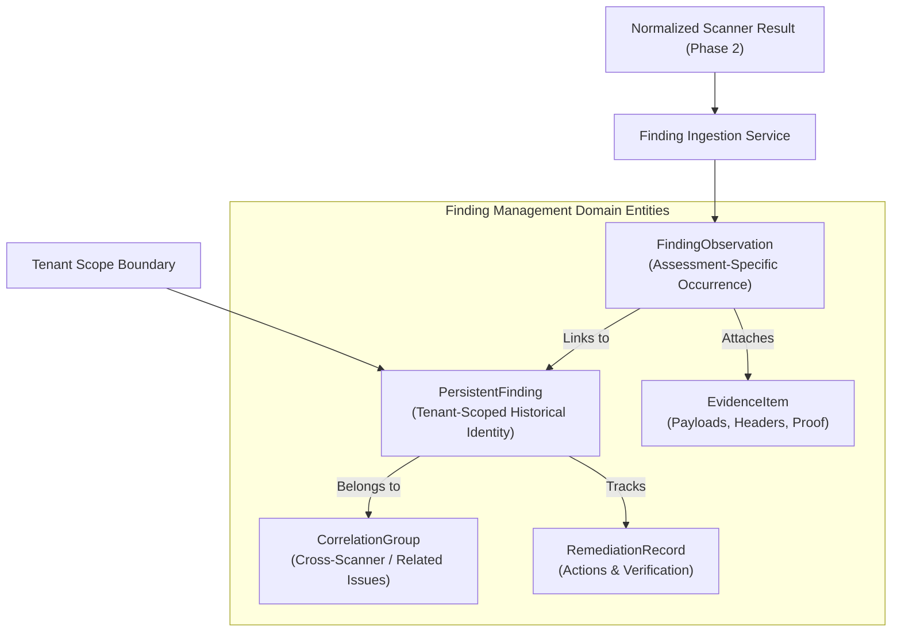

# P3-01 — Define the Finding Management Domain and Lifecycle

**Parent Epic:** [Phase 3 — Findings Intelligence, Evidence & Reporting](../MILESTONE_PHASE_3.md)  
**Milestone:** [Phase 3 — Findings Intelligence, Evidence & Reporting](../MILESTONE_PHASE_3.md)  
**Workstream:** Workstream A — Finding Foundation & Lifecycle  
**Status:** `ready-for-dev`  

---

## 🎯 Purpose

Establish the domain model and lifecycle semantics for findings created from Phase 2 assessment results.

---

## 📐 Architecture & Workflow Diagram

---

## 📋 Detailed Requirements

- Define the distinction between: a normalized scanner result, a finding observation from a particular assessment, a persistent finding tracked across assessments, and a correlation group containing related findings.
- Define how findings are created, updated, reopened, resolved, accepted, and marked as false positive.
- Define how a finding relates to: Tenant, Target or asset reference, Assessment, Scanner and detection rule, Observation, Evidence, and Remediation record.
- Define the ownership boundaries between findings, observations, evidence, and remediation.
- Establish lifecycle rules that preserve history instead of overwriting previous assessment observations.
- Define which data is immutable and which fields are mutable.
- Ensure the model is compatible with the canonical finding and evidence schemas established in Phase 1 and used in Phase 2.

---

## 🛡️ Security & Architectural Invariants

- **Tenant Isolation:** All finding, observation, evidence, remediation, and report records must enforce strict tenant boundaries (`tenant_id = current_tenant_id()`, ADR-0002).
- **Data Integrity & Traceability:** Individual assessment observations and evidence records must remain immutable and never be overwritten by subsequent assessments.
- **Evidence Protection:** All sensitive credentials, tokens, session cookies, and authorization headers must be redacted before presentation and export (ADR-0005).
- **Explainability:** All calculated risk scores and priority rankings must be reproducible and mathematically explainable from documented input factors.

---

## ✅ Acceptance Criteria

- [ ] Finding domain terminology is documented.
- [ ] Persistent findings and individual observations are distinct concepts.
- [ ] Relationships and ownership boundaries are documented.
- [ ] Lifecycle states and permitted transitions are defined.
- [ ] Schema changes are documented through the established ADR and migration process.
- [ ] Phase 2 result ingestion can map into the proposed domain without losing scanner provenance.

---

## 🔗 Related Documentation & Links

- Findings Domain Architecture: [`docs/architecture/FINDINGS_DOMAIN.md`](../../../docs/architecture/FINDING_SCHEMA.md)
- Evidence Retention & Redaction: [`docs/security/EVIDENCE_LIFECYCLE.md`](../../../docs/security/ACCEPTABLE_USE.md)
- Risk Scoring Specification: [`docs/architecture/RISK_SCORING_MODEL.md`](../../../docs/architecture/SCAN_PROFILES.md)
- System Architecture Baseline: [`docs/architecture/SYSTEM_ARCHITECTURE.md`](../../../docs/architecture/SYSTEM_ARCHITECTURE.md)
