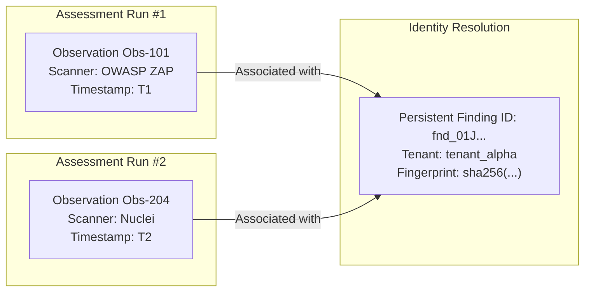

# P3-02 — Define the Finding Identity and Observation Model

**Parent Epic:** [Phase 3 — Findings Intelligence, Evidence & Reporting](../MILESTONE_PHASE_3.md)  
**Milestone:** [Phase 3 — Findings Intelligence, Evidence & Reporting](../MILESTONE_PHASE_3.md)  
**Workstream:** Workstream A — Finding Foundation & Lifecycle  
**Status:** `ready-for-dev`  

---

## 🎯 Purpose

Design a stable identity model so KELVIN can recognize the same issue across multiple assessments without treating every scanner observation as a separate vulnerability.

---

## 📐 Architecture & Workflow Diagram

---

## 📋 Detailed Requirements

- Define a persistent finding identifier (UUIDv7).
- Define a separate identifier for each finding observation.
- Ensure each observation references its source assessment and scanner.
- Define how multiple observations may belong to one persistent finding.
- Define how findings are separated by tenant and authorized target context.
- Ensure observations preserve their original scanner-specific data and timestamps.
- Define behavior when a finding changes location, rule version, or target identity.
- Avoid merging findings solely because their descriptions or titles are similar.
- Document the identity model and its known limitations.

---

## 🛡️ Security & Architectural Invariants

- **Tenant Isolation:** All finding, observation, evidence, remediation, and report records must enforce strict tenant boundaries (`tenant_id = current_tenant_id()`, ADR-0002).
- **Data Integrity & Traceability:** Individual assessment observations and evidence records must remain immutable and never be overwritten by subsequent assessments.
- **Evidence Protection:** All sensitive credentials, tokens, session cookies, and authorization headers must be redacted before presentation and export (ADR-0005).
- **Explainability:** All calculated risk scores and priority rankings must be reproducible and mathematically explainable from documented input factors.

---

## ✅ Acceptance Criteria

- [ ] Finding and observation identities are distinct.
- [ ] Each observation has traceable assessment and scanner provenance.
- [ ] Tenant boundaries are part of identity and matching decisions.
- [ ] Changes in scanner metadata do not silently erase historical observations.
- [ ] Matching behavior is documented and testable.

---

## 🔗 Related Documentation & Links

- Findings Domain Architecture: [`docs/architecture/FINDINGS_DOMAIN.md`](../../../docs/architecture/FINDING_SCHEMA.md)
- Evidence Retention & Redaction: [`docs/security/EVIDENCE_LIFECYCLE.md`](../../../docs/security/ACCEPTABLE_USE.md)
- Risk Scoring Specification: [`docs/architecture/RISK_SCORING_MODEL.md`](../../../docs/architecture/SCAN_PROFILES.md)
- System Architecture Baseline: [`docs/architecture/SYSTEM_ARCHITECTURE.md`](../../../docs/architecture/SYSTEM_ARCHITECTURE.md)
