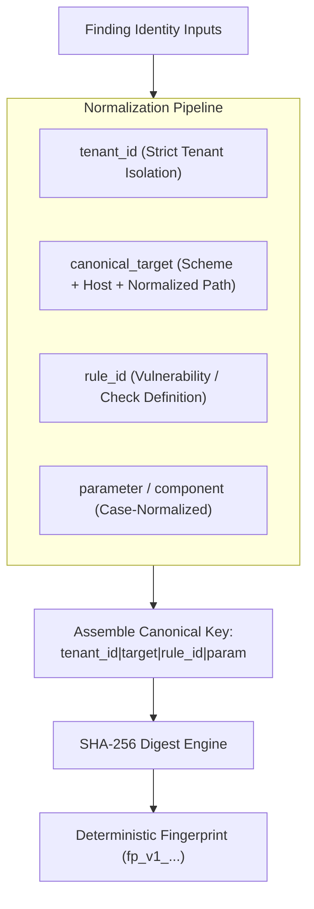

# P3-03 — Implement Deterministic Finding Fingerprinting

**Parent Epic:** [Phase 3 — Findings Intelligence, Evidence & Reporting](../MILESTONE_PHASE_3.md)  
**Milestone:** [Phase 3 — Findings Intelligence, Evidence & Reporting](../MILESTONE_PHASE_3.md)  
**Workstream:** Workstream A — Finding Foundation & Lifecycle  
**Status:** `ready-for-dev`  

---

## 🎯 Purpose

Implement stable fingerprints that identify likely recurring findings without relying on unstable fields such as timestamps or changing evidence text.

---

## 📐 Architecture & Workflow Diagram

---

## 📋 Detailed Requirements

- Define a deterministic fingerprint generation algorithm.
- Use appropriate identity inputs: Tenant context, Canonical target or asset reference, Scanner rule or vulnerability identifier, Normalized affected location, and relevant parameter or component identity.
- Exclude volatile information such as timestamps, request IDs, temporary values, and raw response bodies.
- Normalize URLs and relevant location fields before fingerprint generation.
- Define versioning for the fingerprint algorithm (e.g. fingerprint_v1).
- Preserve previous fingerprint values when the algorithm changes.
- Avoid cross-tenant fingerprint matching.
- Define how ambiguous matches are handled instead of automatically merging them.

---

## 🛡️ Security & Architectural Invariants

- **Tenant Isolation:** All finding, observation, evidence, remediation, and report records must enforce strict tenant boundaries (`tenant_id = current_tenant_id()`, ADR-0002).
- **Data Integrity & Traceability:** Individual assessment observations and evidence records must remain immutable and never be overwritten by subsequent assessments.
- **Evidence Protection:** All sensitive credentials, tokens, session cookies, and authorization headers must be redacted before presentation and export (ADR-0005).
- **Explainability:** All calculated risk scores and priority rankings must be reproducible and mathematically explainable from documented input factors.

---

## ✅ Acceptance Criteria

- [ ] Identical qualifying inputs produce the same fingerprint.
- [ ] Meaningfully different finding identities produce different fingerprints.
- [ ] Fingerprints are deterministic across application instances.
- [ ] Algorithm version is traceable.
- [ ] Tests cover URL normalization, missing fields, scanner changes, and ambiguous cases.

---

## 🔗 Related Documentation & Links

- Findings Domain Architecture: [`docs/architecture/FINDINGS_DOMAIN.md`](../../../docs/architecture/FINDING_SCHEMA.md)
- Evidence Retention & Redaction: [`docs/security/EVIDENCE_LIFECYCLE.md`](../../../docs/security/ACCEPTABLE_USE.md)
- Risk Scoring Specification: [`docs/architecture/RISK_SCORING_MODEL.md`](../../../docs/architecture/SCAN_PROFILES.md)
- System Architecture Baseline: [`docs/architecture/SYSTEM_ARCHITECTURE.md`](../../../docs/architecture/SYSTEM_ARCHITECTURE.md)
