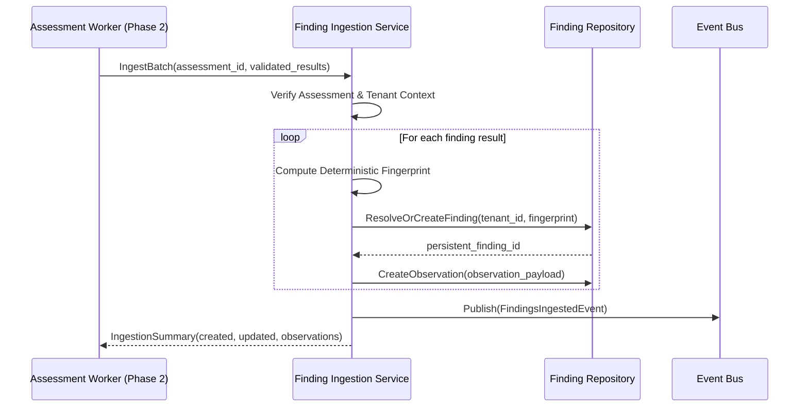

# P3-04 — Implement the Finding Ingestion Service

**Parent Epic:** [Phase 3 — Findings Intelligence, Evidence & Reporting](../MILESTONE_PHASE_3.md)  
**Milestone:** [Phase 3 — Findings Intelligence, Evidence & Reporting](../MILESTONE_PHASE_3.md)  
**Workstream:** Workstream A — Finding Foundation & Lifecycle  
**Status:** `ready-for-dev`  

---

## 🎯 Purpose

Create the application-layer service that accepts validated normalized results from Phase 2 and converts them into persistent finding observations.

---

## 📐 Architecture & Workflow Diagram

---

## 📋 Detailed Requirements

- Implement an ingestion service independent of scanner-specific adapters.
- Accept only normalized and validated Phase 2 result structures.
- Resolve tenant, assessment, target, and scanner references.
- Validate finding and observation relationships.
- Generate or resolve persistent finding identities.
- Create observation records for individual assessment results.
- Preserve scanner-specific metadata and provenance.
- Reject results belonging to missing, inaccessible, or invalid assessments.
- Define behavior for incomplete or partially completed assessments.
- Do not expose a public endpoint that allows arbitrary clients to inject trusted findings.

---

## 🛡️ Security & Architectural Invariants

- **Tenant Isolation:** All finding, observation, evidence, remediation, and report records must enforce strict tenant boundaries (`tenant_id = current_tenant_id()`, ADR-0002).
- **Data Integrity & Traceability:** Individual assessment observations and evidence records must remain immutable and never be overwritten by subsequent assessments.
- **Evidence Protection:** All sensitive credentials, tokens, session cookies, and authorization headers must be redacted before presentation and export (ADR-0005).
- **Explainability:** All calculated risk scores and priority rankings must be reproducible and mathematically explainable from documented input factors.

---

## ✅ Acceptance Criteria

- [ ] Valid Phase 2 results can be ingested.
- [ ] Invalid or untrusted records are rejected safely.
- [ ] Findings and observations retain source provenance.
- [ ] Ingestion is implemented in the application/domain layer rather than inside scanner adapters.
- [ ] Unit and integration tests cover valid, invalid, and partial assessment results.

---

## 🔗 Related Documentation & Links

- Findings Domain Architecture: [`docs/architecture/FINDINGS_DOMAIN.md`](../../../docs/architecture/FINDING_SCHEMA.md)
- Evidence Retention & Redaction: [`docs/security/EVIDENCE_LIFECYCLE.md`](../../../docs/security/ACCEPTABLE_USE.md)
- Risk Scoring Specification: [`docs/architecture/RISK_SCORING_MODEL.md`](../../../docs/architecture/SCAN_PROFILES.md)
- System Architecture Baseline: [`docs/architecture/SYSTEM_ARCHITECTURE.md`](../../../docs/architecture/SYSTEM_ARCHITECTURE.md)
