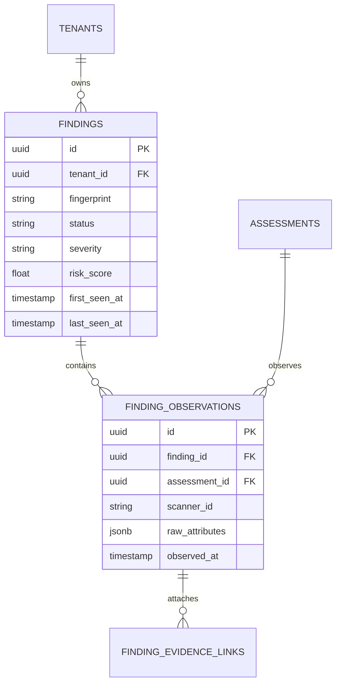

# P3-05 — Implement Finding and Observation Persistence

**Parent Epic:** [Phase 3 — Findings Intelligence, Evidence & Reporting](../MILESTONE_PHASE_3.md)  
**Milestone:** [Phase 3 — Findings Intelligence, Evidence & Reporting](../MILESTONE_PHASE_3.md)  
**Workstream:** Workstream A — Finding Foundation & Lifecycle  
**Status:** `ready-for-dev`  

---

## 🎯 Purpose

Persist findings and individual observations while preserving their relationships and historical integrity.

---

## 📐 Architecture & Workflow Diagram

---

## 📋 Detailed Requirements

- Create the required database migrations for findings and observations.
- Implement repositories for findings and observations in PostgreSQL.
- Define appropriate indexes for tenant, finding identifier, assessment identifier, fingerprint, status, and timestamps.
- Define referential integrity constraints with ON DELETE RESTRICT.
- Preserve observation history when a finding is updated.
- Avoid overwriting earlier scanner observations with newer values.
- Support efficient retrieval of a finding's observation history.
- Use database transactions for operations that require atomicity.
- Follow established Phase 1 persistence and migration conventions.

---

## 🛡️ Security & Architectural Invariants

- **Tenant Isolation:** All finding, observation, evidence, remediation, and report records must enforce strict tenant boundaries (`tenant_id = current_tenant_id()`, ADR-0002).
- **Data Integrity & Traceability:** Individual assessment observations and evidence records must remain immutable and never be overwritten by subsequent assessments.
- **Evidence Protection:** All sensitive credentials, tokens, session cookies, and authorization headers must be redacted before presentation and export (ADR-0005).
- **Explainability:** All calculated risk scores and priority rankings must be reproducible and mathematically explainable from documented input factors.

---

## ✅ Acceptance Criteria

- [ ] Findings and observations are persisted with correct relationships.
- [ ] Migrations are reversible where the migration strategy supports it.
- [ ] Referential integrity is enforced.
- [ ] Historical observations remain available after subsequent assessments.
- [ ] Repository and migration tests pass.

---

## 🔗 Related Documentation & Links

- Findings Domain Architecture: [`docs/architecture/FINDINGS_DOMAIN.md`](../../../docs/architecture/FINDING_SCHEMA.md)
- Evidence Retention & Redaction: [`docs/security/EVIDENCE_LIFECYCLE.md`](../../../docs/security/ACCEPTABLE_USE.md)
- Risk Scoring Specification: [`docs/architecture/RISK_SCORING_MODEL.md`](../../../docs/architecture/SCAN_PROFILES.md)
- System Architecture Baseline: [`docs/architecture/SYSTEM_ARCHITECTURE.md`](../../../docs/architecture/SYSTEM_ARCHITECTURE.md)
