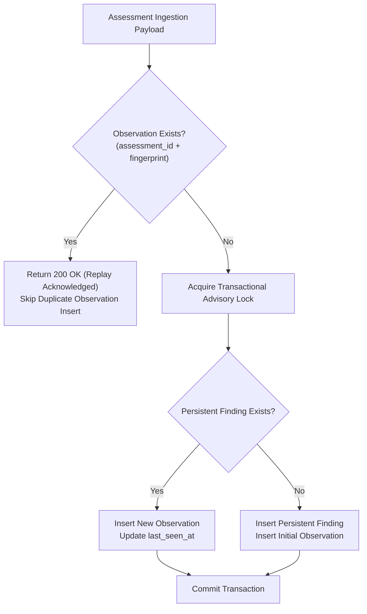

# P3-06 — Enforce Idempotent Finding Ingestion

**Parent Epic:** [Phase 3 — Findings Intelligence, Evidence & Reporting](../MILESTONE_PHASE_3.md)  
**Milestone:** [Phase 3 — Findings Intelligence, Evidence & Reporting](../MILESTONE_PHASE_3.md)  
**Workstream:** Workstream A — Finding Foundation & Lifecycle  
**Status:** `ready-for-dev`  

---

## 🎯 Purpose

Ensure repeated ingestion of the same assessment results does not create duplicate findings or observations.

---

## 📐 Architecture & Workflow Diagram

---

## 📋 Detailed Requirements

- Reuse Phase 1 idempotency principles.
- Define an idempotency boundary for assessment-result ingestion.
- Prevent duplicate observation creation when the same result is delivered more than once.
- Handle concurrent ingestion attempts safely using database constraints.
- Distinguish a repeated delivery from a genuinely new observation in a later assessment.
- Ensure retries do not reset finding status or overwrite analyst decisions.
- Record rejected or replayed ingestion attempts where operationally useful.

---

## 🛡️ Security & Architectural Invariants

- **Tenant Isolation:** All finding, observation, evidence, remediation, and report records must enforce strict tenant boundaries (`tenant_id = current_tenant_id()`, ADR-0002).
- **Data Integrity & Traceability:** Individual assessment observations and evidence records must remain immutable and never be overwritten by subsequent assessments.
- **Evidence Protection:** All sensitive credentials, tokens, session cookies, and authorization headers must be redacted before presentation and export (ADR-0005).
- **Explainability:** All calculated risk scores and priority rankings must be reproducible and mathematically explainable from documented input factors.

---

## ✅ Acceptance Criteria

- [ ] Repeated ingestion of identical result data does not create duplicate observations.
- [ ] Concurrent ingestion is safe.
- [ ] A new assessment can create a new observation for an existing finding.
- [ ] Existing analyst decisions are not silently reset.
- [ ] Tests cover retries, queue redelivery, and concurrent ingestion.

---

## 🔗 Related Documentation & Links

- Findings Domain Architecture: [`docs/architecture/FINDINGS_DOMAIN.md`](../../../docs/architecture/FINDING_SCHEMA.md)
- Evidence Retention & Redaction: [`docs/security/EVIDENCE_LIFECYCLE.md`](../../../docs/security/ACCEPTABLE_USE.md)
- Risk Scoring Specification: [`docs/architecture/RISK_SCORING_MODEL.md`](../../../docs/architecture/SCAN_PROFILES.md)
- System Architecture Baseline: [`docs/architecture/SYSTEM_ARCHITECTURE.md`](../../../docs/architecture/SYSTEM_ARCHITECTURE.md)
