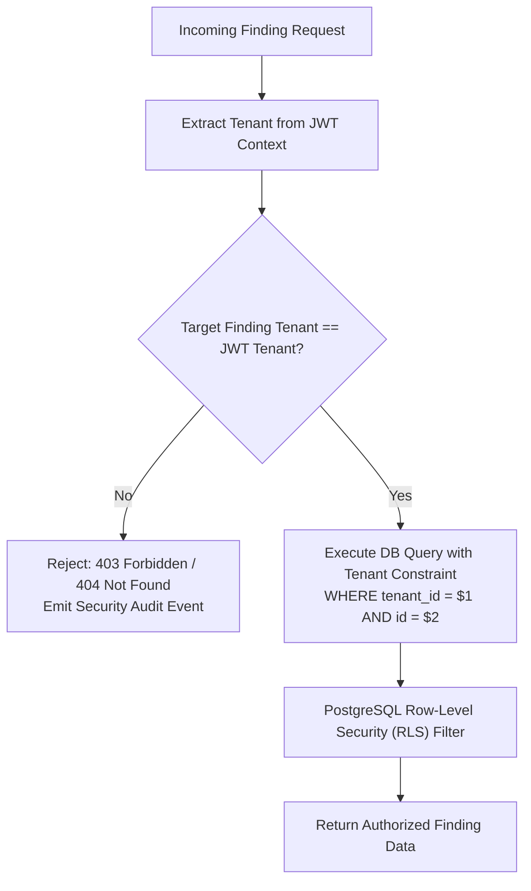

# P3-07 — Enforce Tenant-Scoped Finding Repository Boundaries

**Parent Epic:** [Phase 3 — Findings Intelligence, Evidence & Reporting](../MILESTONE_PHASE_3.md)  
**Milestone:** [Phase 3 — Findings Intelligence, Evidence & Reporting](../MILESTONE_PHASE_3.md)  
**Workstream:** Workstream A — Finding Foundation & Lifecycle  
**Status:** `ready-for-dev`  

---

## 🎯 Purpose

Ensure all finding and observation operations respect the tenant isolation model established in Phase 1.

---

## 📐 Architecture & Workflow Diagram

---

## 📋 Detailed Requirements

- Require tenant context in finding repository operations.
- Apply tenant filtering to list, detail, update, export, and history retrieval operations.
- Prevent direct object-reference (IDOR) access from bypassing tenant authorization.
- Validate tenant ownership when linking findings to assessments and evidence.
- Avoid cross-tenant correlation and deduplication.
- Review database access paths and query patterns for isolation weaknesses.
- Ensure unauthorized access attempts are handled consistently with application security standards.

---

## 🛡️ Security & Architectural Invariants

- **Tenant Isolation:** All finding, observation, evidence, remediation, and report records must enforce strict tenant boundaries (`tenant_id = current_tenant_id()`, ADR-0002).
- **Data Integrity & Traceability:** Individual assessment observations and evidence records must remain immutable and never be overwritten by subsequent assessments.
- **Evidence Protection:** All sensitive credentials, tokens, session cookies, and authorization headers must be redacted before presentation and export (ADR-0005).
- **Explainability:** All calculated risk scores and priority rankings must be reproducible and mathematically explainable from documented input factors.

---

## ✅ Acceptance Criteria

- [ ] Finding repository operations are tenant-scoped.
- [ ] Cross-tenant reads and writes are rejected.
- [ ] Finding identifiers cannot be used to bypass authorization.
- [ ] Automated tests verify isolation across read, write, and history operations.
- [ ] No known cross-tenant access path remains.

---

## 🔗 Related Documentation & Links

- Findings Domain Architecture: [`docs/architecture/FINDINGS_DOMAIN.md`](../../../docs/architecture/FINDING_SCHEMA.md)
- Evidence Retention & Redaction: [`docs/security/EVIDENCE_LIFECYCLE.md`](../../../docs/security/ACCEPTABLE_USE.md)
- Risk Scoring Specification: [`docs/architecture/RISK_SCORING_MODEL.md`](../../../docs/architecture/SCAN_PROFILES.md)
- System Architecture Baseline: [`docs/architecture/SYSTEM_ARCHITECTURE.md`](../../../docs/architecture/SYSTEM_ARCHITECTURE.md)
