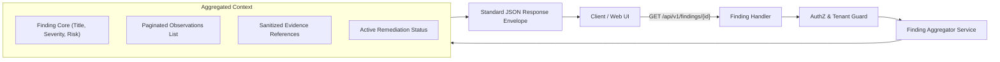

# P3-08 — Implement Finding Detail Retrieval API

**Parent Epic:** [Phase 3 — Findings Intelligence, Evidence & Reporting](../MILESTONE_PHASE_3.md)  
**Milestone:** [Phase 3 — Findings Intelligence, Evidence & Reporting](../MILESTONE_PHASE_3.md)  
**Workstream:** Workstream A — Finding Foundation & Lifecycle  
**Status:** `ready-for-dev`  

---

## 🎯 Purpose

Provide an authorized API endpoint for retrieving a finding and its relevant assessment context.

---

## 📐 Architecture & Workflow Diagram

---

## 📋 Detailed Requirements

- Implement a finding detail endpoint (GET /api/v1/findings/{id}) using established API conventions.
- Return: Finding identity, Current status, Severity and risk metadata, Target reference, First and most recent observation timestamps, Related assessments, Scanner provenance, Evidence references, and Remediation state.
- Define pagination for observation history.
- Enforce tenant authorization and object-level access checks.
- Avoid returning raw sensitive evidence by default.
- Follow the standardized response and error envelope from Phase 1.
- Document the endpoint in OpenAPI.

---

## 🛡️ Security & Architectural Invariants

- **Tenant Isolation:** All finding, observation, evidence, remediation, and report records must enforce strict tenant boundaries (`tenant_id = current_tenant_id()`, ADR-0002).
- **Data Integrity & Traceability:** Individual assessment observations and evidence records must remain immutable and never be overwritten by subsequent assessments.
- **Evidence Protection:** All sensitive credentials, tokens, session cookies, and authorization headers must be redacted before presentation and export (ADR-0005).
- **Explainability:** All calculated risk scores and priority rankings must be reproducible and mathematically explainable from documented input factors.

---

## ✅ Acceptance Criteria

- [ ] Authorized users can retrieve their permitted finding details.
- [ ] Unauthorized access is rejected.
- [ ] Observation history is paginated.
- [ ] Sensitive evidence is not exposed unintentionally.
- [ ] OpenAPI documentation and API tests are available.

---

## 🔗 Related Documentation & Links

- Findings Domain Architecture: [`docs/architecture/FINDINGS_DOMAIN.md`](../../../docs/architecture/FINDING_SCHEMA.md)
- Evidence Retention & Redaction: [`docs/security/EVIDENCE_LIFECYCLE.md`](../../../docs/security/ACCEPTABLE_USE.md)
- Risk Scoring Specification: [`docs/architecture/RISK_SCORING_MODEL.md`](../../../docs/architecture/SCAN_PROFILES.md)
- System Architecture Baseline: [`docs/architecture/SYSTEM_ARCHITECTURE.md`](../../../docs/architecture/SYSTEM_ARCHITECTURE.md)
