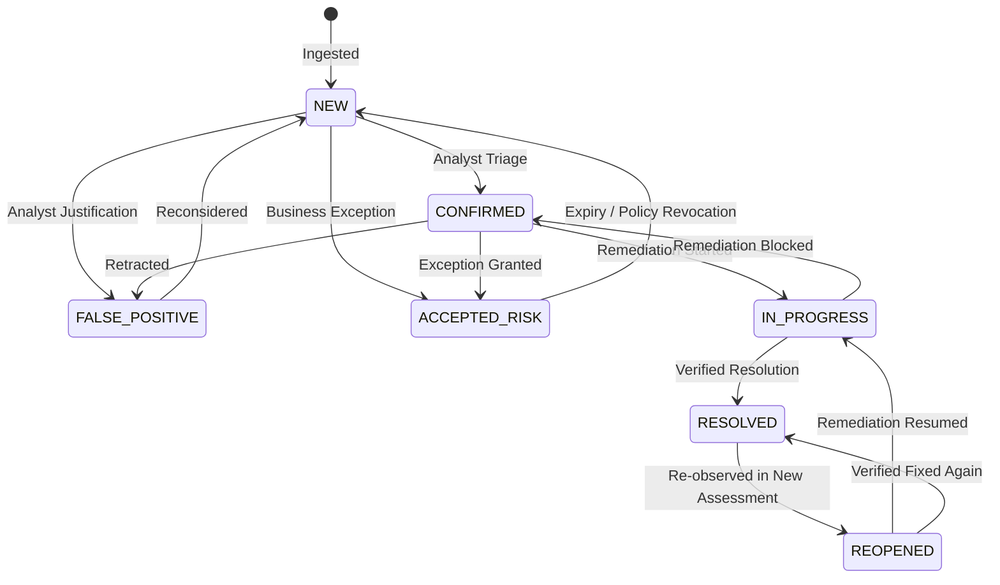

# P3-09 — Implement the Finding Lifecycle State Machine

**Parent Epic:** [Phase 3 — Findings Intelligence, Evidence & Reporting](../MILESTONE_PHASE_3.md)  
**Milestone:** [Phase 3 — Findings Intelligence, Evidence & Reporting](../MILESTONE_PHASE_3.md)  
**Workstream:** Workstream A — Finding Foundation & Lifecycle  
**Status:** `ready-for-dev`  

---

## 🎯 Purpose

Define and implement controlled lifecycle transitions for persistent findings.

---

## 📐 Architecture & Workflow Diagram

---

## 📋 Detailed Requirements

- Support approved lifecycle states: New, Confirmed, In Progress, Resolved, Accepted Risk, False Positive, Reopened.
- Define permitted transitions between states.
- Define which transitions require analyst action and which can be triggered by verified assessment results.
- Prevent scanner output from directly changing analyst-controlled states without a defined policy.
- Define how findings reappear after being resolved.
- Preserve prior state and transition history.
- Document how accepted-risk and false-positive states differ.

---

## 🛡️ Security & Architectural Invariants

- **Tenant Isolation:** All finding, observation, evidence, remediation, and report records must enforce strict tenant boundaries (`tenant_id = current_tenant_id()`, ADR-0002).
- **Data Integrity & Traceability:** Individual assessment observations and evidence records must remain immutable and never be overwritten by subsequent assessments.
- **Evidence Protection:** All sensitive credentials, tokens, session cookies, and authorization headers must be redacted before presentation and export (ADR-0005).
- **Explainability:** All calculated risk scores and priority rankings must be reproducible and mathematically explainable from documented input factors.

---

## ✅ Acceptance Criteria

- [ ] Lifecycle states are formally defined.
- [ ] Invalid transitions are rejected.
- [ ] Automated and manual transitions are distinguishable.
- [ ] Previous state history is preserved.
- [ ] State-machine tests cover all supported transitions.

---

## 🔗 Related Documentation & Links

- Findings Domain Architecture: [`docs/architecture/FINDINGS_DOMAIN.md`](../../../docs/architecture/FINDING_SCHEMA.md)
- Evidence Retention & Redaction: [`docs/security/EVIDENCE_LIFECYCLE.md`](../../../docs/security/ACCEPTABLE_USE.md)
- Risk Scoring Specification: [`docs/architecture/RISK_SCORING_MODEL.md`](../../../docs/architecture/SCAN_PROFILES.md)
- System Architecture Baseline: [`docs/architecture/SYSTEM_ARCHITECTURE.md`](../../../docs/architecture/SYSTEM_ARCHITECTURE.md)
