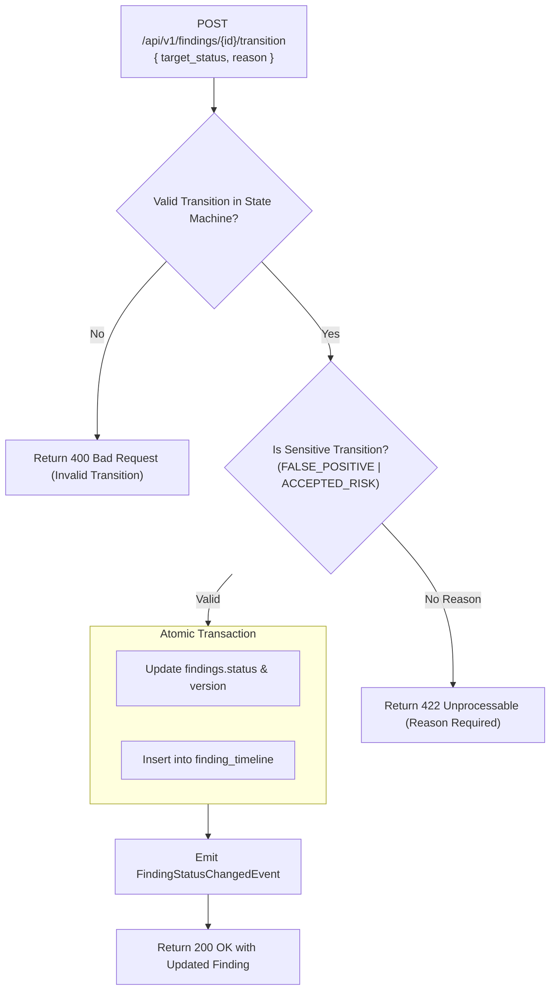

# P3-10 — Implement Finding Status Transition Commands and API

**Parent Epic:** [Phase 3 — Findings Intelligence, Evidence & Reporting](../MILESTONE_PHASE_3.md)  
**Milestone:** [Phase 3 — Findings Intelligence, Evidence & Reporting](../MILESTONE_PHASE_3.md)  
**Workstream:** Workstream A — Finding Foundation & Lifecycle  
**Status:** `ready-for-dev`  

---

## 🎯 Purpose

Allow authorized users and internal services to perform valid finding lifecycle transitions.

---

## 📐 Architecture & Workflow Diagram

---

## 📋 Detailed Requirements

- Implement application commands for supported state changes.
- Expose authorized API endpoints (POST /api/v1/findings/{id}/transition) for manual transitions.
- Validate transitions through the state machine from P3-09.
- Require a reason for sensitive transitions such as accepted risk and false positive.
- Prevent users from changing findings outside their authorized tenant and access scope.
- Ensure concurrent status changes do not silently overwrite one another using optimistic locking.
- Return clear validation errors for invalid transitions.
- Record actor and timestamp for each transition.

---

## 🛡️ Security & Architectural Invariants

- **Tenant Isolation:** All finding, observation, evidence, remediation, and report records must enforce strict tenant boundaries (`tenant_id = current_tenant_id()`, ADR-0002).
- **Data Integrity & Traceability:** Individual assessment observations and evidence records must remain immutable and never be overwritten by subsequent assessments.
- **Evidence Protection:** All sensitive credentials, tokens, session cookies, and authorization headers must be redacted before presentation and export (ADR-0005).
- **Explainability:** All calculated risk scores and priority rankings must be reproducible and mathematically explainable from documented input factors.

---

## ✅ Acceptance Criteria

- [ ] Authorized users can perform permitted transitions.
- [ ] Invalid transitions are rejected.
- [ ] Sensitive transitions require documented reasons.
- [ ] Concurrent updates are handled safely.
- [ ] Status changes are traceable.

---

## 🔗 Related Documentation & Links

- Findings Domain Architecture: [`docs/architecture/FINDINGS_DOMAIN.md`](../../../docs/architecture/FINDING_SCHEMA.md)
- Evidence Retention & Redaction: [`docs/security/EVIDENCE_LIFECYCLE.md`](../../../docs/security/ACCEPTABLE_USE.md)
- Risk Scoring Specification: [`docs/architecture/RISK_SCORING_MODEL.md`](../../../docs/architecture/SCAN_PROFILES.md)
- System Architecture Baseline: [`docs/architecture/SYSTEM_ARCHITECTURE.md`](../../../docs/architecture/SYSTEM_ARCHITECTURE.md)
