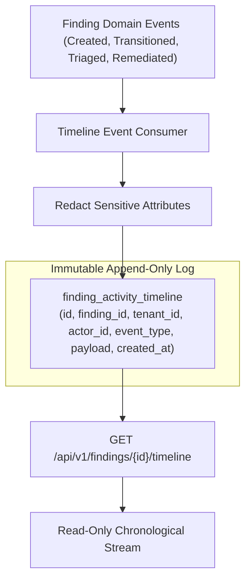

# P3-11 — Implement an Immutable Finding Activity Timeline

**Parent Epic:** [Phase 3 — Findings Intelligence, Evidence & Reporting](../MILESTONE_PHASE_3.md)  
**Milestone:** [Phase 3 — Findings Intelligence, Evidence & Reporting](../MILESTONE_PHASE_3.md)  
**Workstream:** Workstream A — Finding Foundation & Lifecycle  
**Status:** `ready-for-dev`  

---

## 🎯 Purpose

Provide a chronological record of significant finding activity for auditability and investigation.

---

## 📐 Architecture & Workflow Diagram

---

## 📋 Detailed Requirements

- Record finding creation and observation events.
- Record status transitions, severity, and risk-score changes.
- Record false-positive and accepted-risk decisions.
- Record assignment and remediation changes.
- Record evidence additions and removal events.
- Store actor, event type, timestamp, and relevant non-sensitive metadata.
- Prevent ordinary application operations from rewriting historical activity.
- Reuse the audit and append-only design principles established in Phase 1.
- Define pagination and retention behavior.

---

## 🛡️ Security & Architectural Invariants

- **Tenant Isolation:** All finding, observation, evidence, remediation, and report records must enforce strict tenant boundaries (`tenant_id = current_tenant_id()`, ADR-0002).
- **Data Integrity & Traceability:** Individual assessment observations and evidence records must remain immutable and never be overwritten by subsequent assessments.
- **Evidence Protection:** All sensitive credentials, tokens, session cookies, and authorization headers must be redacted before presentation and export (ADR-0005).
- **Explainability:** All calculated risk scores and priority rankings must be reproducible and mathematically explainable from documented input factors.

---

## ✅ Acceptance Criteria

- [ ] Significant finding events are recorded.
- [ ] Timeline records contain actor and timestamp information where applicable.
- [ ] History cannot be silently rewritten through normal application operations.
- [ ] Sensitive values are excluded or redacted.
- [ ] Tests verify event creation and access restrictions.

---

## 🔗 Related Documentation & Links

- Findings Domain Architecture: [`docs/architecture/FINDINGS_DOMAIN.md`](../../../docs/architecture/FINDING_SCHEMA.md)
- Evidence Retention & Redaction: [`docs/security/EVIDENCE_LIFECYCLE.md`](../../../docs/security/ACCEPTABLE_USE.md)
- Risk Scoring Specification: [`docs/architecture/RISK_SCORING_MODEL.md`](../../../docs/architecture/SCAN_PROFILES.md)
- System Architecture Baseline: [`docs/architecture/SYSTEM_ARCHITECTURE.md`](../../../docs/architecture/SYSTEM_ARCHITECTURE.md)
