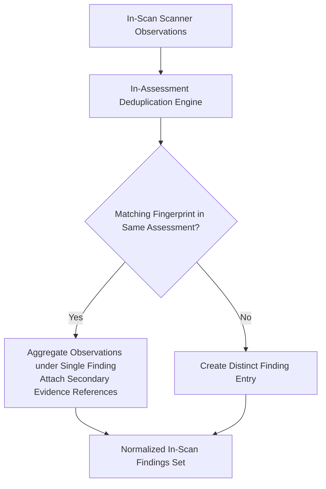

# P3-12 — Implement Same-Assessment Duplicate Detection

**Parent Epic:** [Phase 3 — Findings Intelligence, Evidence & Reporting](../MILESTONE_PHASE_3.md)  
**Milestone:** [Phase 3 — Findings Intelligence, Evidence & Reporting](../MILESTONE_PHASE_3.md)  
**Workstream:** Workstream B — Deduplication, Correlation & Triage  
**Status:** `ready-for-dev`  

---

## 🎯 Purpose

Avoid creating multiple persistent findings for repeated or overlapping scanner results within a single assessment.

---

## 📐 Architecture & Workflow Diagram

---

## 📋 Detailed Requirements

- Use the fingerprinting mechanism established in P3-03.
- Detect identical results reported more than once within an assessment.
- Preserve the source information from all relevant scanner observations.
- Define how duplicate records are handled when their evidence differs.
- Avoid merging findings solely because titles or descriptions match.
- Record duplicate detection decisions for debugging.
- Ensure duplicate handling does not discard distinct vulnerabilities at different locations.

---

## 🛡️ Security & Architectural Invariants

- **Tenant Isolation:** All finding, observation, evidence, remediation, and report records must enforce strict tenant boundaries (`tenant_id = current_tenant_id()`, ADR-0002).
- **Data Integrity & Traceability:** Individual assessment observations and evidence records must remain immutable and never be overwritten by subsequent assessments.
- **Evidence Protection:** All sensitive credentials, tokens, session cookies, and authorization headers must be redacted before presentation and export (ADR-0005).
- **Explainability:** All calculated risk scores and priority rankings must be reproducible and mathematically explainable from documented input factors.

---

## ✅ Acceptance Criteria

- [ ] Exact qualifying duplicates are identified.
- [ ] Distinct findings remain separate.
- [ ] Source scanner information is preserved.
- [ ] Duplicate handling is deterministic.
- [ ] Tests cover same-scanner and cross-scanner duplicate cases.

---

## 🔗 Related Documentation & Links

- Findings Domain Architecture: [`docs/architecture/FINDINGS_DOMAIN.md`](../../../docs/architecture/FINDING_SCHEMA.md)
- Evidence Retention & Redaction: [`docs/security/EVIDENCE_LIFECYCLE.md`](../../../docs/security/ACCEPTABLE_USE.md)
- Risk Scoring Specification: [`docs/architecture/RISK_SCORING_MODEL.md`](../../../docs/architecture/SCAN_PROFILES.md)
- System Architecture Baseline: [`docs/architecture/SYSTEM_ARCHITECTURE.md`](../../../docs/architecture/SYSTEM_ARCHITECTURE.md)
