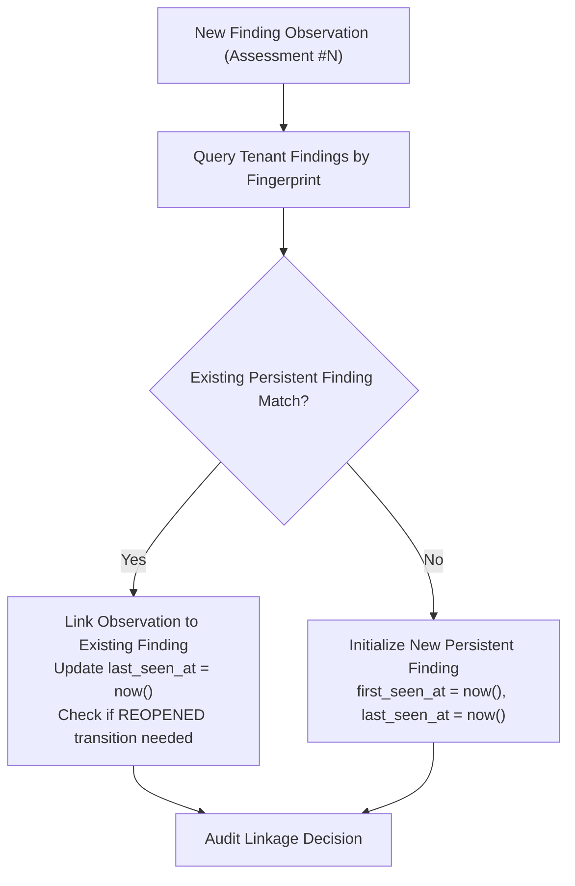

# P3-13 — Implement Cross-Assessment Recurring Finding Detection

**Parent Epic:** [Phase 3 — Findings Intelligence, Evidence & Reporting](../MILESTONE_PHASE_3.md)  
**Milestone:** [Phase 3 — Findings Intelligence, Evidence & Reporting](../MILESTONE_PHASE_3.md)  
**Workstream:** Workstream B — Deduplication, Correlation & Triage  
**Status:** `ready-for-dev`  

---

## 🎯 Purpose

Recognize when a finding detected in a new assessment corresponds to an existing finding.

---

## 📐 Architecture & Workflow Diagram

---

## 📋 Detailed Requirements

- Match new observations against existing findings within the same tenant.
- Use the versioned fingerprint strategy.
- Consider canonical target and location information.
- Define handling for changed URL parameters and dynamic paths.
- Ensure uncertain matches are not automatically merged without sufficient evidence.
- Associate new observations with existing findings when the matching threshold is satisfied.
- Create a new finding when no reliable match exists.
- Record matching decisions and algorithm version.

---

## 🛡️ Security & Architectural Invariants

- **Tenant Isolation:** All finding, observation, evidence, remediation, and report records must enforce strict tenant boundaries (`tenant_id = current_tenant_id()`, ADR-0002).
- **Data Integrity & Traceability:** Individual assessment observations and evidence records must remain immutable and never be overwritten by subsequent assessments.
- **Evidence Protection:** All sensitive credentials, tokens, session cookies, and authorization headers must be redacted before presentation and export (ADR-0005).
- **Explainability:** All calculated risk scores and priority rankings must be reproducible and mathematically explainable from documented input factors.

---

## ✅ Acceptance Criteria

- [ ] Recurring findings can be linked across assessments.
- [ ] New observations do not unnecessarily create duplicate persistent findings.
- [ ] Uncertain matches are handled conservatively.
- [ ] Tenant isolation is maintained.
- [ ] Tests cover recurrence, changed locations, and ambiguous matches.

---

## 🔗 Related Documentation & Links

- Findings Domain Architecture: [`docs/architecture/FINDINGS_DOMAIN.md`](../../../docs/architecture/FINDING_SCHEMA.md)
- Evidence Retention & Redaction: [`docs/security/EVIDENCE_LIFECYCLE.md`](../../../docs/security/ACCEPTABLE_USE.md)
- Risk Scoring Specification: [`docs/architecture/RISK_SCORING_MODEL.md`](../../../docs/architecture/SCAN_PROFILES.md)
- System Architecture Baseline: [`docs/architecture/SYSTEM_ARCHITECTURE.md`](../../../docs/architecture/SYSTEM_ARCHITECTURE.md)
