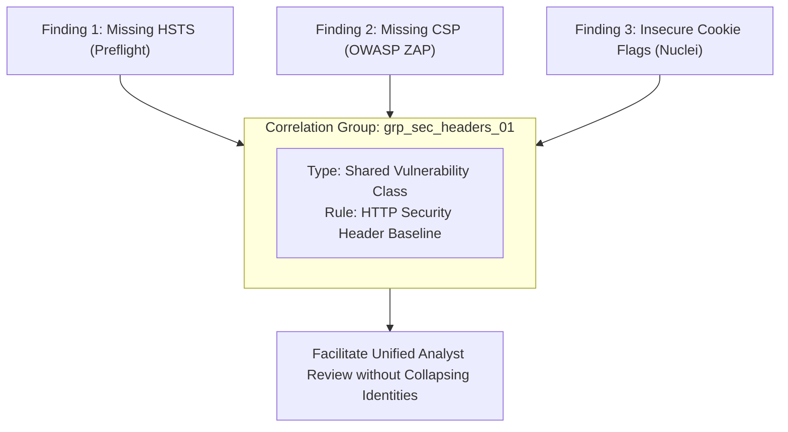

# P3-14 — Define the Finding Correlation Group Model

**Parent Epic:** [Phase 3 — Findings Intelligence, Evidence & Reporting](../MILESTONE_PHASE_3.md)  
**Milestone:** [Phase 3 — Findings Intelligence, Evidence & Reporting](../MILESTONE_PHASE_3.md)  
**Workstream:** Workstream B — Deduplication, Correlation & Triage  
**Status:** `ready-for-dev`  

---

## 🎯 Purpose

Provide a model for grouping related findings without merging their independent identities.

---

## 📐 Architecture & Workflow Diagram

---

## 📋 Detailed Requirements

- Define correlation groups separately from persistent finding records.
- Support groups based on documented relationships: Same underlying issue reported by different scanners, Related findings affecting the same target, Findings associated with a common vulnerability identifier.
- Define group membership and lifecycle rules.
- Preserve individual finding status, evidence, and history.
- Define how a finding joins or leaves a group.
- Avoid cross-tenant grouping.
- Document the difference between duplicate identity and broader correlation.

---

## 🛡️ Security & Architectural Invariants

- **Tenant Isolation:** All finding, observation, evidence, remediation, and report records must enforce strict tenant boundaries (`tenant_id = current_tenant_id()`, ADR-0002).
- **Data Integrity & Traceability:** Individual assessment observations and evidence records must remain immutable and never be overwritten by subsequent assessments.
- **Evidence Protection:** All sensitive credentials, tokens, session cookies, and authorization headers must be redacted before presentation and export (ADR-0005).
- **Explainability:** All calculated risk scores and priority rankings must be reproducible and mathematically explainable from documented input factors.

---

## ✅ Acceptance Criteria

- [ ] Correlation groups have independent identifiers.
- [ ] Group membership does not destroy individual finding records.
- [ ] Grouping rules are documented.
- [ ] Tenant boundaries are respected.
- [ ] Membership operations are tested.

---

## 🔗 Related Documentation & Links

- Findings Domain Architecture: [`docs/architecture/FINDINGS_DOMAIN.md`](../../../docs/architecture/FINDING_SCHEMA.md)
- Evidence Retention & Redaction: [`docs/security/EVIDENCE_LIFECYCLE.md`](../../../docs/security/ACCEPTABLE_USE.md)
- Risk Scoring Specification: [`docs/architecture/RISK_SCORING_MODEL.md`](../../../docs/architecture/SCAN_PROFILES.md)
- System Architecture Baseline: [`docs/architecture/SYSTEM_ARCHITECTURE.md`](../../../docs/architecture/SYSTEM_ARCHITECTURE.md)
