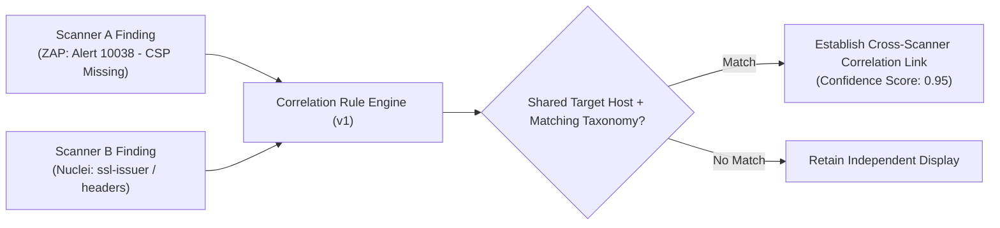

# P3-15 — Implement Cross-Scanner Finding Correlation Rules

**Parent Epic:** [Phase 3 — Findings Intelligence, Evidence & Reporting](../MILESTONE_PHASE_3.md)  
**Milestone:** [Phase 3 — Findings Intelligence, Evidence & Reporting](../MILESTONE_PHASE_3.md)  
**Workstream:** Workstream B — Deduplication, Correlation & Triage  
**Status:** `ready-for-dev`  

---

## 🎯 Purpose

Identify related findings produced by different scanner integrations and present their relationship to analysts.

---

## 📐 Architecture & Workflow Diagram

---

## 📋 Detailed Requirements

- Implement a rule-based correlation mechanism.
- Use available rule identifiers, affected targets, locations, and structured metadata.
- Define confidence thresholds for correlation.
- Preserve original scanner findings and their source metadata.
- Avoid merging unrelated findings merely because they share a severity or description.
- Version correlation rules.
- Record why two findings were grouped.
- Allow future correlation strategies without replacing the core finding identity model.

---

## 🛡️ Security & Architectural Invariants

- **Tenant Isolation:** All finding, observation, evidence, remediation, and report records must enforce strict tenant boundaries (`tenant_id = current_tenant_id()`, ADR-0002).
- **Data Integrity & Traceability:** Individual assessment observations and evidence records must remain immutable and never be overwritten by subsequent assessments.
- **Evidence Protection:** All sensitive credentials, tokens, session cookies, and authorization headers must be redacted before presentation and export (ADR-0005).
- **Explainability:** All calculated risk scores and priority rankings must be reproducible and mathematically explainable from documented input factors.

---

## ✅ Acceptance Criteria

- [ ] Supported scanner findings can be correlated using documented rules.
- [ ] Correlation decisions are explainable.
- [ ] Original finding records remain independent.
- [ ] Correlation rules are versioned.
- [ ] Tests include true-match and false-match scenarios.

---

## 🔗 Related Documentation & Links

- Findings Domain Architecture: [`docs/architecture/FINDINGS_DOMAIN.md`](../../../docs/architecture/FINDING_SCHEMA.md)
- Evidence Retention & Redaction: [`docs/security/EVIDENCE_LIFECYCLE.md`](../../../docs/security/ACCEPTABLE_USE.md)
- Risk Scoring Specification: [`docs/architecture/RISK_SCORING_MODEL.md`](../../../docs/architecture/SCAN_PROFILES.md)
- System Architecture Baseline: [`docs/architecture/SYSTEM_ARCHITECTURE.md`](../../../docs/architecture/SYSTEM_ARCHITECTURE.md)
