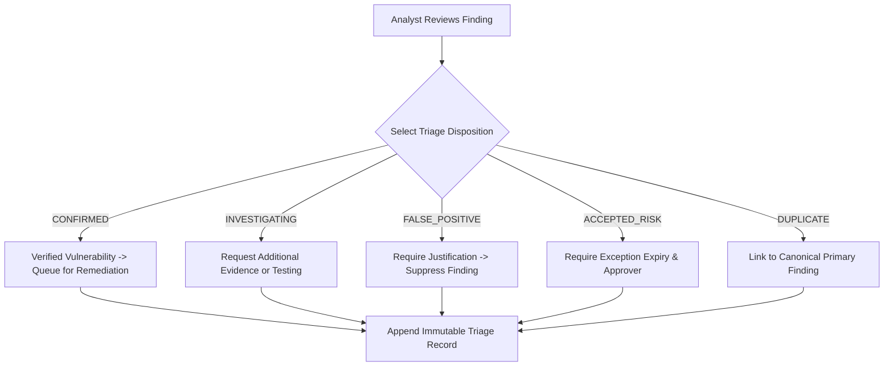

# P3-16 — Define Finding Triage Decisions and Dispositions

**Parent Epic:** [Phase 3 — Findings Intelligence, Evidence & Reporting](../MILESTONE_PHASE_3.md)  
**Milestone:** [Phase 3 — Findings Intelligence, Evidence & Reporting](../MILESTONE_PHASE_3.md)  
**Workstream:** Workstream B — Deduplication, Correlation & Triage  
**Status:** `ready-for-dev`  

---

## 🎯 Purpose

Standardize the decisions analysts can make when reviewing findings.

---

## 📐 Architecture & Workflow Diagram

---

## 📋 Detailed Requirements

- Define supported triage dispositions: Confirmed issue, Needs further investigation, False positive, Accepted risk, Duplicate or related finding.
- Define required decision metadata for each disposition.
- Define whether a disposition applies to a persistent finding, an individual observation, or a correlation group.
- Prevent a temporary review decision from silently suppressing future observations.
- Define how dispositions interact with lifecycle states.
- Ensure decisions are auditable.

---

## 🛡️ Security & Architectural Invariants

- **Tenant Isolation:** All finding, observation, evidence, remediation, and report records must enforce strict tenant boundaries (`tenant_id = current_tenant_id()`, ADR-0002).
- **Data Integrity & Traceability:** Individual assessment observations and evidence records must remain immutable and never be overwritten by subsequent assessments.
- **Evidence Protection:** All sensitive credentials, tokens, session cookies, and authorization headers must be redacted before presentation and export (ADR-0005).
- **Explainability:** All calculated risk scores and priority rankings must be reproducible and mathematically explainable from documented input factors.

---

## ✅ Acceptance Criteria

- [ ] Triage dispositions are documented.
- [ ] Each disposition has clear semantics and scope.
- [ ] Sensitive decisions require a reason.
- [ ] Dispositions are linked to the responsible actor.
- [ ] Tests verify valid and invalid disposition operations.

---

## 🔗 Related Documentation & Links

- Findings Domain Architecture: [`docs/architecture/FINDINGS_DOMAIN.md`](../../../docs/architecture/FINDING_SCHEMA.md)
- Evidence Retention & Redaction: [`docs/security/EVIDENCE_LIFECYCLE.md`](../../../docs/security/ACCEPTABLE_USE.md)
- Risk Scoring Specification: [`docs/architecture/RISK_SCORING_MODEL.md`](../../../docs/architecture/SCAN_PROFILES.md)
- System Architecture Baseline: [`docs/architecture/SYSTEM_ARCHITECTURE.md`](../../../docs/architecture/SYSTEM_ARCHITECTURE.md)
