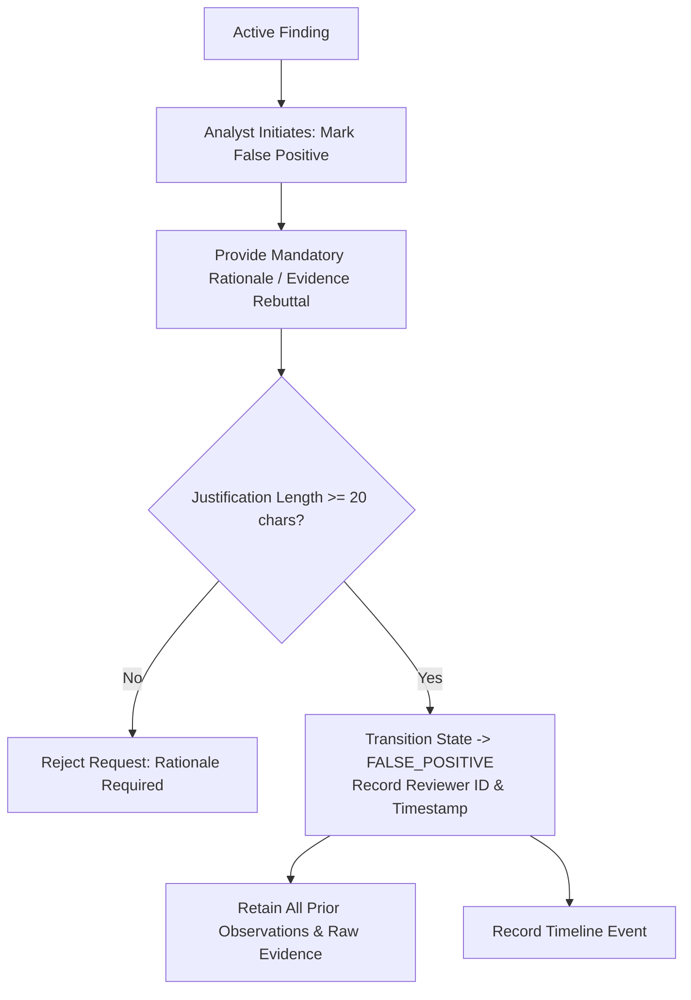

# P3-17 — Implement False-Positive Review and Management

**Parent Epic:** [Phase 3 — Findings Intelligence, Evidence & Reporting](../MILESTONE_PHASE_3.md)  
**Milestone:** [Phase 3 — Findings Intelligence, Evidence & Reporting](../MILESTONE_PHASE_3.md)  
**Workstream:** Workstream B — Deduplication, Correlation & Triage  
**Status:** `ready-for-dev`  

---

## 🎯 Purpose

Allow authorized analysts to classify findings as false positive while preserving the evidence and decision history.

---

## 📐 Architecture & Workflow Diagram

---

## 📋 Detailed Requirements

- Implement the false-positive decision workflow.
- Require a justification for the decision.
- Record reviewer identity and timestamp.
- Preserve the original scanner observations.
- Allow authorized reconsideration or reversal.
- Distinguish false-positive status from permanent evidence deletion.
- Ensure a new observation can trigger review when relevant characteristics materially change.
- Record all changes in the finding activity timeline.

---

## 🛡️ Security & Architectural Invariants

- **Tenant Isolation:** All finding, observation, evidence, remediation, and report records must enforce strict tenant boundaries (`tenant_id = current_tenant_id()`, ADR-0002).
- **Data Integrity & Traceability:** Individual assessment observations and evidence records must remain immutable and never be overwritten by subsequent assessments.
- **Evidence Protection:** All sensitive credentials, tokens, session cookies, and authorization headers must be redacted before presentation and export (ADR-0005).
- **Explainability:** All calculated risk scores and priority rankings must be reproducible and mathematically explainable from documented input factors.

---

## ✅ Acceptance Criteria

- [ ] Authorized analysts can mark findings as false positive.
- [ ] Decisions require a reason.
- [ ] Historical observations remain available.
- [ ] Reversal is possible through an authorized transition.
- [ ] Changes are auditable.

---

## 🔗 Related Documentation & Links

- Findings Domain Architecture: [`docs/architecture/FINDINGS_DOMAIN.md`](../../../docs/architecture/FINDING_SCHEMA.md)
- Evidence Retention & Redaction: [`docs/security/EVIDENCE_LIFECYCLE.md`](../../../docs/security/ACCEPTABLE_USE.md)
- Risk Scoring Specification: [`docs/architecture/RISK_SCORING_MODEL.md`](../../../docs/architecture/SCAN_PROFILES.md)
- System Architecture Baseline: [`docs/architecture/SYSTEM_ARCHITECTURE.md`](../../../docs/architecture/SYSTEM_ARCHITECTURE.md)
