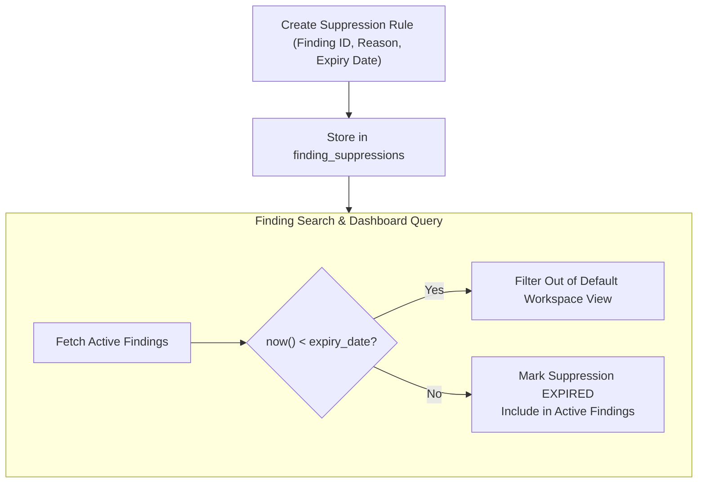

# P3-18 — Implement Finding Suppression Rules with Expiry

**Parent Epic:** [Phase 3 — Findings Intelligence, Evidence & Reporting](../MILESTONE_PHASE_3.md)  
**Milestone:** [Phase 3 — Findings Intelligence, Evidence & Reporting](../MILESTONE_PHASE_3.md)  
**Workstream:** Workstream B — Deduplication, Correlation & Triage  
**Status:** `ready-for-dev`  

---

## 🎯 Purpose

Allow findings to be temporarily or conditionally excluded from routine review without destroying their records.

---

## 📐 Architecture & Workflow Diagram

---

## 📋 Detailed Requirements

- Define suppression separately from deletion and false-positive classification.
- Support finding-level suppression.
- Define optional suppression criteria that are safe and narrowly scoped.
- Require a justification.
- Support expiry timestamps.
- Define behavior when a suppression expires.
- Prevent broad suppression rules from accidentally applying across unrelated targets or tenants.
- Record the user or service responsible for creating or modifying each rule.
- Ensure suppressed findings remain accessible to authorized reviewers.

---

## 🛡️ Security & Architectural Invariants

- **Tenant Isolation:** All finding, observation, evidence, remediation, and report records must enforce strict tenant boundaries (`tenant_id = current_tenant_id()`, ADR-0002).
- **Data Integrity & Traceability:** Individual assessment observations and evidence records must remain immutable and never be overwritten by subsequent assessments.
- **Evidence Protection:** All sensitive credentials, tokens, session cookies, and authorization headers must be redacted before presentation and export (ADR-0005).
- **Explainability:** All calculated risk scores and priority rankings must be reproducible and mathematically explainable from documented input factors.

---

## ✅ Acceptance Criteria

- [ ] Suppression rules can be created and revoked.
- [ ] Expiry is enforced.
- [ ] Suppression does not delete underlying findings.
- [ ] Rule scope and tenant boundaries are enforced.
- [ ] Suppression decisions are auditable.

---

## 🔗 Related Documentation & Links

- Findings Domain Architecture: [`docs/architecture/FINDINGS_DOMAIN.md`](../../../docs/architecture/FINDING_SCHEMA.md)
- Evidence Retention & Redaction: [`docs/security/EVIDENCE_LIFECYCLE.md`](../../../docs/security/ACCEPTABLE_USE.md)
- Risk Scoring Specification: [`docs/architecture/RISK_SCORING_MODEL.md`](../../../docs/architecture/SCAN_PROFILES.md)
- System Architecture Baseline: [`docs/architecture/SYSTEM_ARCHITECTURE.md`](../../../docs/architecture/SYSTEM_ARCHITECTURE.md)
