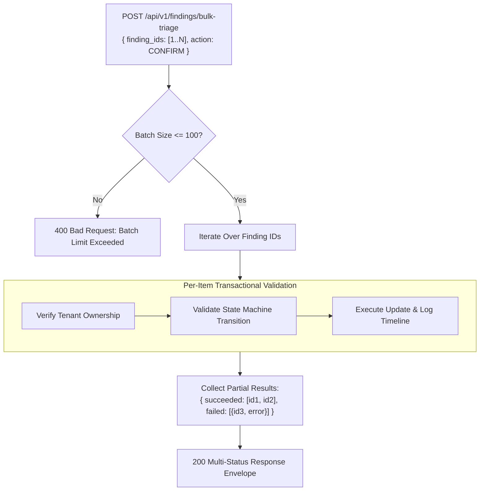

# P3-19 — Implement Bulk Finding Triage Operations

**Parent Epic:** [Phase 3 — Findings Intelligence, Evidence & Reporting](../MILESTONE_PHASE_3.md)  
**Milestone:** [Phase 3 — Findings Intelligence, Evidence & Reporting](../MILESTONE_PHASE_3.md)  
**Workstream:** Workstream B — Deduplication, Correlation & Triage  
**Status:** `ready-for-dev`  

---

## 🎯 Purpose

Allow analysts to manage multiple findings efficiently while maintaining individual authorization and lifecycle rules.

---

## 📐 Architecture & Workflow Diagram

---

## 📋 Detailed Requirements

- Support bulk status changes where permitted.
- Support bulk assignment to an authorized user where assignment is available.
- Support bulk disposition only where the operation is safe.
- Validate each selected finding independently.
- Enforce a maximum batch size (e.g. 100 items).
- Prevent partial failures from being reported as full success.
- Return per-item success and failure information.
- Record bulk operation metadata and individual state changes.
- Require confirmation or an explicit reason for high-impact operations.

---

## 🛡️ Security & Architectural Invariants

- **Tenant Isolation:** All finding, observation, evidence, remediation, and report records must enforce strict tenant boundaries (`tenant_id = current_tenant_id()`, ADR-0002).
- **Data Integrity & Traceability:** Individual assessment observations and evidence records must remain immutable and never be overwritten by subsequent assessments.
- **Evidence Protection:** All sensitive credentials, tokens, session cookies, and authorization headers must be redacted before presentation and export (ADR-0005).
- **Explainability:** All calculated risk scores and priority rankings must be reproducible and mathematically explainable from documented input factors.

---

## ✅ Acceptance Criteria

- [ ] Authorized users can submit bounded bulk operations.
- [ ] Each finding is individually validated.
- [ ] Partial failures are reported clearly.
- [ ] Audit history is maintained per finding.
- [ ] Tests cover mixed-authority and mixed-result batches.

---

## 🔗 Related Documentation & Links

- Findings Domain Architecture: [`docs/architecture/FINDINGS_DOMAIN.md`](../../../docs/architecture/FINDING_SCHEMA.md)
- Evidence Retention & Redaction: [`docs/security/EVIDENCE_LIFECYCLE.md`](../../../docs/security/ACCEPTABLE_USE.md)
- Risk Scoring Specification: [`docs/architecture/RISK_SCORING_MODEL.md`](../../../docs/architecture/SCAN_PROFILES.md)
- System Architecture Baseline: [`docs/architecture/SYSTEM_ARCHITECTURE.md`](../../../docs/architecture/SYSTEM_ARCHITECTURE.md)
