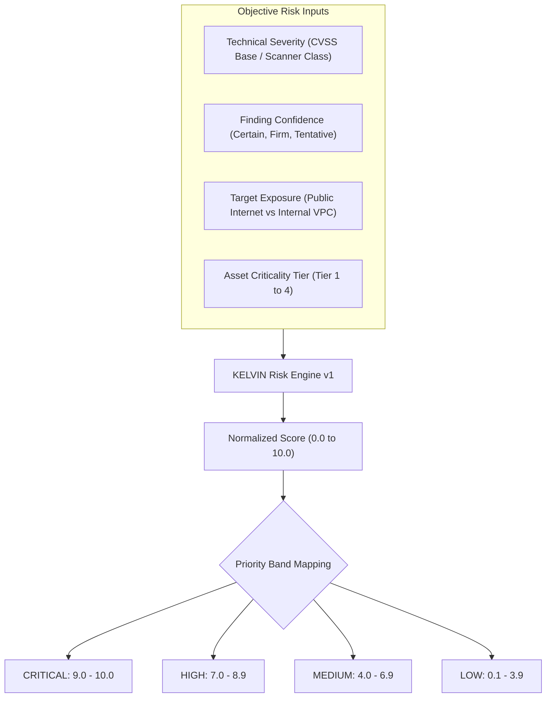

# P3-20 — Define the KELVIN Risk Assessment Model

**Parent Epic:** [Phase 3 — Findings Intelligence, Evidence & Reporting](../MILESTONE_PHASE_3.md)  
**Milestone:** [Phase 3 — Findings Intelligence, Evidence & Reporting](../MILESTONE_PHASE_3.md)  
**Workstream:** Workstream C — Risk Intelligence & Prioritization  
**Status:** `ready-for-dev`  

---

## 🎯 Purpose

Define a consistent risk model that helps users prioritize findings beyond the severity label supplied by an individual scanner.

---

## 📐 Architecture & Workflow Diagram

---

## 📋 Detailed Requirements

- Define the distinction between scanner severity and KELVIN risk.
- Identify approved risk inputs: Normalized severity, Finding confidence, Exposure context, Affected target context, Relevant vulnerability metadata.
- Define which inputs are mandatory and which are optional.
- Define how missing context affects the score.
- Avoid implying mathematical precision unsupported by the available data.
- Document the scoring philosophy and limitations.
- Keep enterprise-wide business impact analysis outside the initial implementation.

---

## 🛡️ Security & Architectural Invariants

- **Tenant Isolation:** All finding, observation, evidence, remediation, and report records must enforce strict tenant boundaries (`tenant_id = current_tenant_id()`, ADR-0002).
- **Data Integrity & Traceability:** Individual assessment observations and evidence records must remain immutable and never be overwritten by subsequent assessments.
- **Evidence Protection:** All sensitive credentials, tokens, session cookies, and authorization headers must be redacted before presentation and export (ADR-0005).
- **Explainability:** All calculated risk scores and priority rankings must be reproducible and mathematically explainable from documented input factors.

---

## ✅ Acceptance Criteria

- [ ] A documented risk model exists.
- [ ] Scanner severity remains preserved independently.
- [ ] Risk inputs and missing-data behavior are defined.
- [ ] The model is explainable.
- [ ] Stakeholder review approves the scoring approach.

---

## 🔗 Related Documentation & Links

- Findings Domain Architecture: [`docs/architecture/FINDINGS_DOMAIN.md`](../../../docs/architecture/FINDING_SCHEMA.md)
- Evidence Retention & Redaction: [`docs/security/EVIDENCE_LIFECYCLE.md`](../../../docs/security/ACCEPTABLE_USE.md)
- Risk Scoring Specification: [`docs/architecture/RISK_SCORING_MODEL.md`](../../../docs/architecture/SCAN_PROFILES.md)
- System Architecture Baseline: [`docs/architecture/SYSTEM_ARCHITECTURE.md`](../../../docs/architecture/SYSTEM_ARCHITECTURE.md)
