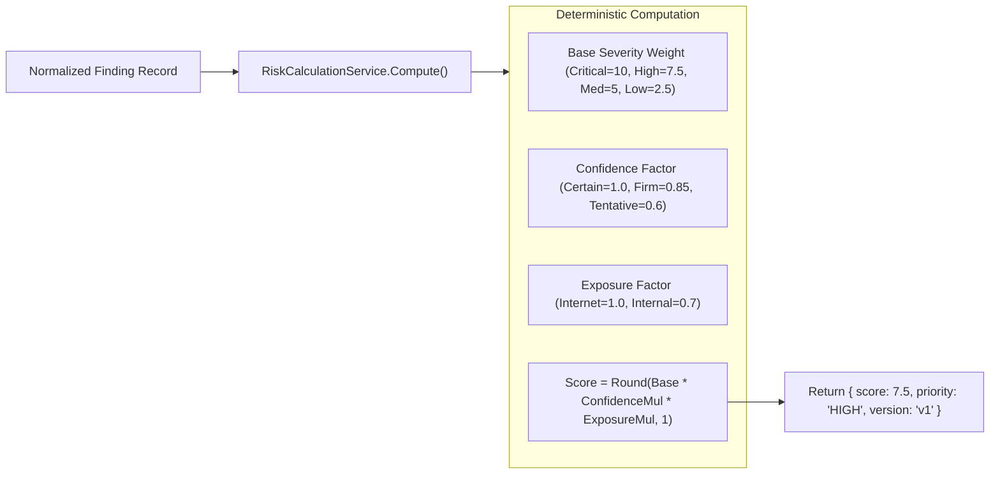

# P3-21 — Implement the Deterministic Risk Scoring Engine

**Parent Epic:** [Phase 3 — Findings Intelligence, Evidence & Reporting](../MILESTONE_PHASE_3.md)  
**Milestone:** [Phase 3 — Findings Intelligence, Evidence & Reporting](../MILESTONE_PHASE_3.md)  
**Workstream:** Workstream C — Risk Intelligence & Prioritization  
**Status:** `ready-for-dev`  

---

## 🎯 Purpose

Implement a consistent scoring service based on the approved KELVIN risk model.

---

## 📐 Architecture & Workflow Diagram

---

## 📋 Detailed Requirements

- Implement scoring in the application/domain layer.
- Use deterministic inputs and documented rules.
- Define a normalized score range (0.0 - 10.0).
- Map scores to documented priority bands.
- Ensure identical inputs and scoring versions produce identical scores.
- Handle missing or unsupported input values safely.
- Keep scanner-specific parsing out of the scoring engine.
- Avoid hard-coded, unexplained adjustments.
- Provide unit tests for scoring boundaries and representative scenarios.

---

## 🛡️ Security & Architectural Invariants

- **Tenant Isolation:** All finding, observation, evidence, remediation, and report records must enforce strict tenant boundaries (`tenant_id = current_tenant_id()`, ADR-0002).
- **Data Integrity & Traceability:** Individual assessment observations and evidence records must remain immutable and never be overwritten by subsequent assessments.
- **Evidence Protection:** All sensitive credentials, tokens, session cookies, and authorization headers must be redacted before presentation and export (ADR-0005).
- **Explainability:** All calculated risk scores and priority rankings must be reproducible and mathematically explainable from documented input factors.

---

## ✅ Acceptance Criteria

- [ ] The risk engine produces deterministic results.
- [ ] Score calculations follow the approved model.
- [ ] Priority bands are consistent.
- [ ] Missing data is handled predictably.
- [ ] Unit tests cover boundary and regression cases.

---

## 🔗 Related Documentation & Links

- Findings Domain Architecture: [`docs/architecture/FINDINGS_DOMAIN.md`](../../../docs/architecture/FINDING_SCHEMA.md)
- Evidence Retention & Redaction: [`docs/security/EVIDENCE_LIFECYCLE.md`](../../../docs/security/ACCEPTABLE_USE.md)
- Risk Scoring Specification: [`docs/architecture/RISK_SCORING_MODEL.md`](../../../docs/architecture/SCAN_PROFILES.md)
- System Architecture Baseline: [`docs/architecture/SYSTEM_ARCHITECTURE.md`](../../../docs/architecture/SYSTEM_ARCHITECTURE.md)
