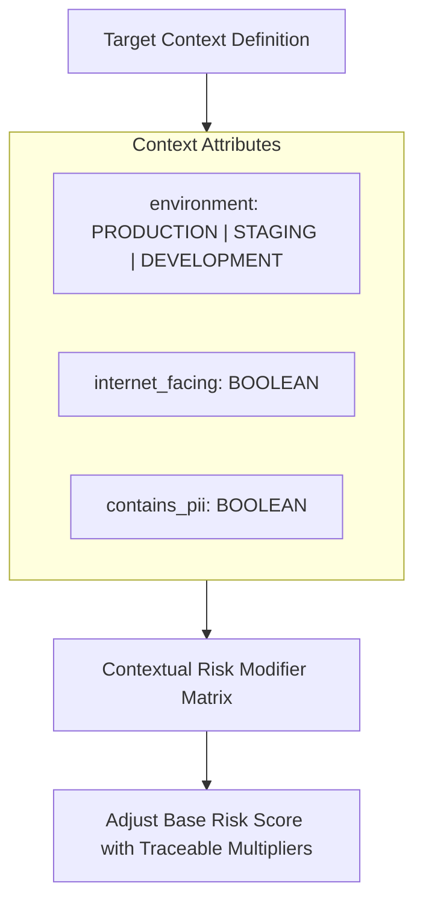

# P3-22 — Implement Contextual Risk Factors

**Parent Epic:** [Phase 3 — Findings Intelligence, Evidence & Reporting](../MILESTONE_PHASE_3.md)  
**Milestone:** [Phase 3 — Findings Intelligence, Evidence & Reporting](../MILESTONE_PHASE_3.md)  
**Workstream:** Workstream C — Risk Intelligence & Prioritization  
**Status:** `ready-for-dev`  

---

## 🎯 Purpose

Allow risk prioritization to consider available target context rather than relying exclusively on scanner severity.

---

## 📐 Architecture & Workflow Diagram

---

## 📋 Detailed Requirements

- Define a small, explicit set of supported target context fields.
- Support optional manual context where approved, such as target importance or exposure classification.
- Validate context inputs and allowed values.
- Define how context affects risk scoring.
- Preserve the source and timestamp of contextual information.
- Avoid inventing asset importance or exposure when it has not been established.
- Ensure tenant-specific context cannot leak across tenants.
- Design the model so Phase 4 can add richer asset inventory integrations.

---

## 🛡️ Security & Architectural Invariants

- **Tenant Isolation:** All finding, observation, evidence, remediation, and report records must enforce strict tenant boundaries (`tenant_id = current_tenant_id()`, ADR-0002).
- **Data Integrity & Traceability:** Individual assessment observations and evidence records must remain immutable and never be overwritten by subsequent assessments.
- **Evidence Protection:** All sensitive credentials, tokens, session cookies, and authorization headers must be redacted before presentation and export (ADR-0005).
- **Explainability:** All calculated risk scores and priority rankings must be reproducible and mathematically explainable from documented input factors.

---

## ✅ Acceptance Criteria

- [ ] Supported context fields are documented.
- [ ] Context can be associated with the correct tenant and target.
- [ ] Invalid values are rejected.
- [ ] Missing context does not produce fabricated risk.
- [ ] Contextual score adjustments are tested and explainable.

---

## 🔗 Related Documentation & Links

- Findings Domain Architecture: [`docs/architecture/FINDINGS_DOMAIN.md`](../../../docs/architecture/FINDING_SCHEMA.md)
- Evidence Retention & Redaction: [`docs/security/EVIDENCE_LIFECYCLE.md`](../../../docs/security/ACCEPTABLE_USE.md)
- Risk Scoring Specification: [`docs/architecture/RISK_SCORING_MODEL.md`](../../../docs/architecture/SCAN_PROFILES.md)
- System Architecture Baseline: [`docs/architecture/SYSTEM_ARCHITECTURE.md`](../../../docs/architecture/SYSTEM_ARCHITECTURE.md)
