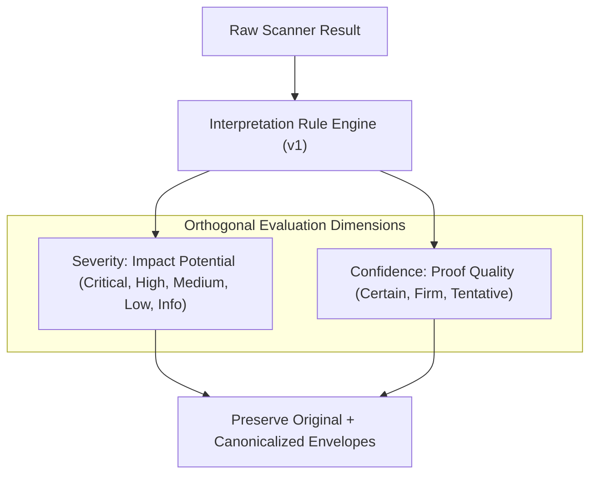

# P3-23 — Implement Confidence and Severity Interpretation Rules

**Parent Epic:** [Phase 3 — Findings Intelligence, Evidence & Reporting](../MILESTONE_PHASE_3.md)  
**Milestone:** [Phase 3 — Findings Intelligence, Evidence & Reporting](../MILESTONE_PHASE_3.md)  
**Workstream:** Workstream C — Risk Intelligence & Prioritization  
**Status:** `ready-for-dev`  

---

## 🎯 Purpose

Ensure severity and confidence are interpreted consistently across scanners without losing the original scanner classifications.

---

## 📐 Architecture & Workflow Diagram

---

## 📋 Detailed Requirements

- Reuse the scanner mappings defined in Phase 2.
- Preserve original scanner severity and confidence values.
- Define KELVIN's canonical interpretation.
- Handle unsupported or missing confidence values explicitly.
- Do not equate high severity with high confidence.
- Define how confidence affects triage and risk prioritization.
- Document exceptions and scanner-specific differences.
- Version interpretation rules.

---

## 🛡️ Security & Architectural Invariants

- **Tenant Isolation:** All finding, observation, evidence, remediation, and report records must enforce strict tenant boundaries (`tenant_id = current_tenant_id()`, ADR-0002).
- **Data Integrity & Traceability:** Individual assessment observations and evidence records must remain immutable and never be overwritten by subsequent assessments.
- **Evidence Protection:** All sensitive credentials, tokens, session cookies, and authorization headers must be redacted before presentation and export (ADR-0005).
- **Explainability:** All calculated risk scores and priority rankings must be reproducible and mathematically explainable from documented input factors.

---

## ✅ Acceptance Criteria

- [ ] Original scanner classifications remain available.
- [ ] Canonical severity and confidence semantics are documented.
- [ ] Missing confidence is represented accurately.
- [ ] High severity and high confidence remain distinct concepts.
- [ ] Tests cover scanner-specific mapping behavior.

---

## 🔗 Related Documentation & Links

- Findings Domain Architecture: [`docs/architecture/FINDINGS_DOMAIN.md`](../../../docs/architecture/FINDING_SCHEMA.md)
- Evidence Retention & Redaction: [`docs/security/EVIDENCE_LIFECYCLE.md`](../../../docs/security/ACCEPTABLE_USE.md)
- Risk Scoring Specification: [`docs/architecture/RISK_SCORING_MODEL.md`](../../../docs/architecture/SCAN_PROFILES.md)
- System Architecture Baseline: [`docs/architecture/SYSTEM_ARCHITECTURE.md`](../../../docs/architecture/SYSTEM_ARCHITECTURE.md)
