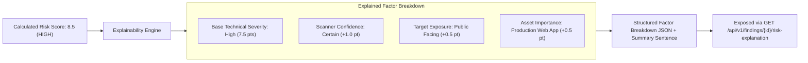

# P3-24 — Implement Risk Score Explainability

**Parent Epic:** [Phase 3 — Findings Intelligence, Evidence & Reporting](../MILESTONE_PHASE_3.md)  
**Milestone:** [Phase 3 — Findings Intelligence, Evidence & Reporting](../MILESTONE_PHASE_3.md)  
**Workstream:** Workstream C — Risk Intelligence & Prioritization  
**Status:** `ready-for-dev`  

---

## 🎯 Purpose

Explain why KELVIN assigned a particular risk score or priority to a finding.

---

## 📐 Architecture & Workflow Diagram

---

## 📋 Detailed Requirements

- Store the scoring model version.
- Record the inputs used in each calculation.
- Expose the relevant factors influencing the score.
- Provide a human-readable explanation.
- Distinguish measured values from manually provided context.
- Avoid exposing internal secrets or sensitive configuration.
- Ensure historical scores remain explainable after scoring rules change.
- Make explanations available through the finding detail API.

---

## 🛡️ Security & Architectural Invariants

- **Tenant Isolation:** All finding, observation, evidence, remediation, and report records must enforce strict tenant boundaries (`tenant_id = current_tenant_id()`, ADR-0002).
- **Data Integrity & Traceability:** Individual assessment observations and evidence records must remain immutable and never be overwritten by subsequent assessments.
- **Evidence Protection:** All sensitive credentials, tokens, session cookies, and authorization headers must be redacted before presentation and export (ADR-0005).
- **Explainability:** All calculated risk scores and priority rankings must be reproducible and mathematically explainable from documented input factors.

---

## ✅ Acceptance Criteria

- [ ] Risk calculations have traceable input metadata.
- [ ] Users can understand the major contributors to a score.
- [ ] Scoring model versions are visible to authorized users.
- [ ] Historical scores remain interpretable.
- [ ] Tests verify explanation consistency with score calculations.

---

## 🔗 Related Documentation & Links

- Findings Domain Architecture: [`docs/architecture/FINDINGS_DOMAIN.md`](../../../docs/architecture/FINDING_SCHEMA.md)
- Evidence Retention & Redaction: [`docs/security/EVIDENCE_LIFECYCLE.md`](../../../docs/security/ACCEPTABLE_USE.md)
- Risk Scoring Specification: [`docs/architecture/RISK_SCORING_MODEL.md`](../../../docs/architecture/SCAN_PROFILES.md)
- System Architecture Baseline: [`docs/architecture/SYSTEM_ARCHITECTURE.md`](../../../docs/architecture/SYSTEM_ARCHITECTURE.md)
