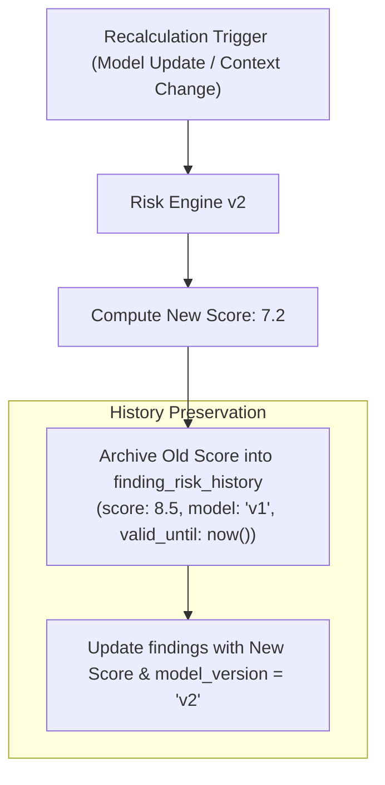

# P3-25 — Implement Versioned Risk Recalculation and History

**Parent Epic:** [Phase 3 — Findings Intelligence, Evidence & Reporting](../MILESTONE_PHASE_3.md)  
**Milestone:** [Phase 3 — Findings Intelligence, Evidence & Reporting](../MILESTONE_PHASE_3.md)  
**Workstream:** Workstream C — Risk Intelligence & Prioritization  
**Status:** `ready-for-dev`  

---

## 🎯 Purpose

Allow KELVIN to evolve its risk model without silently rewriting historical risk decisions.

---

## 📐 Architecture & Workflow Diagram

---

## 📋 Detailed Requirements

- Define when risk scores are recalculated.
- Support recalculation after relevant finding or contextual changes.
- Version the scoring engine and rules.
- Preserve previous score values and model versions.
- Define a controlled migration or recalculation process when rules change.
- Avoid changing finding lifecycle state solely because a score changes.
- Record the cause and timestamp of each recalculation.
- Make the current and historical scores distinguishable.

---

## 🛡️ Security & Architectural Invariants

- **Tenant Isolation:** All finding, observation, evidence, remediation, and report records must enforce strict tenant boundaries (`tenant_id = current_tenant_id()`, ADR-0002).
- **Data Integrity & Traceability:** Individual assessment observations and evidence records must remain immutable and never be overwritten by subsequent assessments.
- **Evidence Protection:** All sensitive credentials, tokens, session cookies, and authorization headers must be redacted before presentation and export (ADR-0005).
- **Explainability:** All calculated risk scores and priority rankings must be reproducible and mathematically explainable from documented input factors.

---

## ✅ Acceptance Criteria

- [ ] Score versions and history are retained.
- [ ] Recalculations are deterministic and auditable.
- [ ] Previous scores are not silently overwritten.
- [ ] Recalculation behavior is documented.
- [ ] Tests cover rule updates and historical preservation.

---

## 🔗 Related Documentation & Links

- Findings Domain Architecture: [`docs/architecture/FINDINGS_DOMAIN.md`](../../../docs/architecture/FINDING_SCHEMA.md)
- Evidence Retention & Redaction: [`docs/security/EVIDENCE_LIFECYCLE.md`](../../../docs/security/ACCEPTABLE_USE.md)
- Risk Scoring Specification: [`docs/architecture/RISK_SCORING_MODEL.md`](../../../docs/architecture/SCAN_PROFILES.md)
- System Architecture Baseline: [`docs/architecture/SYSTEM_ARCHITECTURE.md`](../../../docs/architecture/SYSTEM_ARCHITECTURE.md)
