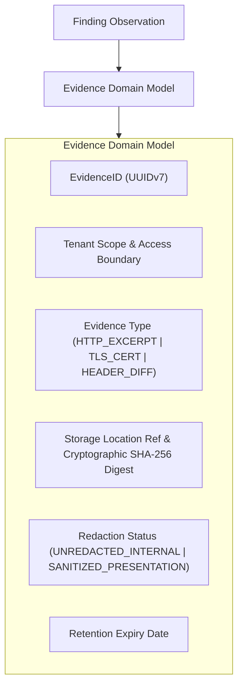

# P3-26 — Define the Evidence Management Domain and Lifecycle

**Parent Epic:** [Phase 3 — Findings Intelligence, Evidence & Reporting](../MILESTONE_PHASE_3.md)  
**Milestone:** [Phase 3 — Findings Intelligence, Evidence & Reporting](../MILESTONE_PHASE_3.md)  
**Workstream:** Workstream D — Evidence Management  
**Status:** `ready-for-dev`  

---

## 🎯 Purpose

Translate the evidence retention and data lifecycle policies established in Phase 1 into an application-level evidence management model.

---

## 📐 Architecture & Workflow Diagram

---

## 📋 Detailed Requirements

- Define supported evidence types: HTTP request and response excerpts, Security header observations, TLS certificate metadata, Scanner result excerpts, and relevant screenshots/files.
- Define evidence metadata and ownership.
- Link evidence to finding observations and assessments.
- Distinguish raw scanner output from curated finding evidence.
- Define sensitivity classifications.
- Define evidence states, retention, expiry, and deletion semantics.
- Ensure evidence is treated as untrusted content.
- Avoid storing unnecessary credentials, tokens, or personal information.

---

## 🛡️ Security & Architectural Invariants

- **Tenant Isolation:** All finding, observation, evidence, remediation, and report records must enforce strict tenant boundaries (`tenant_id = current_tenant_id()`, ADR-0002).
- **Data Integrity & Traceability:** Individual assessment observations and evidence records must remain immutable and never be overwritten by subsequent assessments.
- **Evidence Protection:** All sensitive credentials, tokens, session cookies, and authorization headers must be redacted before presentation and export (ADR-0005).
- **Explainability:** All calculated risk scores and priority rankings must be reproducible and mathematically explainable from documented input factors.

---

## ✅ Acceptance Criteria

- [ ] Evidence domain objects are documented.
- [ ] Evidence types and metadata are defined.
- [ ] Evidence-to-finding and evidence-to-assessment relationships are clear.
- [ ] Retention behavior follows Phase 1 policy.
- [ ] Application and storage responsibilities are documented.

---

## 🔗 Related Documentation & Links

- Findings Domain Architecture: [`docs/architecture/FINDINGS_DOMAIN.md`](../../../docs/architecture/FINDING_SCHEMA.md)
- Evidence Retention & Redaction: [`docs/security/EVIDENCE_LIFECYCLE.md`](../../../docs/security/ACCEPTABLE_USE.md)
- Risk Scoring Specification: [`docs/architecture/RISK_SCORING_MODEL.md`](../../../docs/architecture/SCAN_PROFILES.md)
- System Architecture Baseline: [`docs/architecture/SYSTEM_ARCHITECTURE.md`](../../../docs/architecture/SYSTEM_ARCHITECTURE.md)
