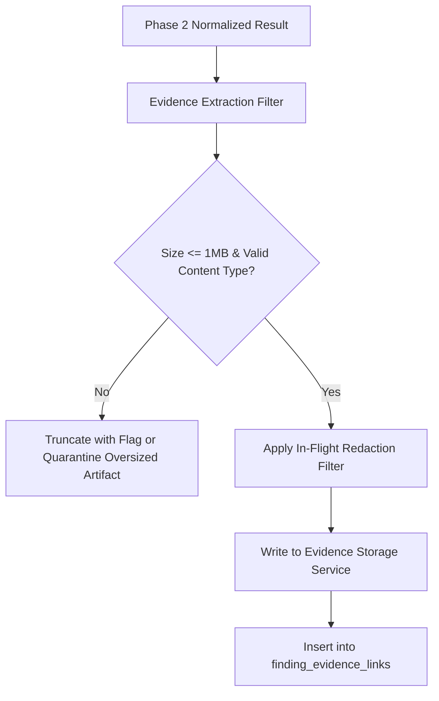

# P3-27 — Implement Evidence Ingestion and Finding Association

**Parent Epic:** [Phase 3 — Findings Intelligence, Evidence & Reporting](../MILESTONE_PHASE_3.md)  
**Milestone:** [Phase 3 — Findings Intelligence, Evidence & Reporting](../MILESTONE_PHASE_3.md)  
**Workstream:** Workstream D — Evidence Management  
**Status:** `ready-for-dev`  

---

## 🎯 Purpose

Extract and associate useful evidence from Phase 2 normalized assessment results without exposing untrusted raw scanner output.

---

## 📐 Architecture & Workflow Diagram

---

## 📋 Detailed Requirements

- Define a controlled evidence ingestion path.
- Accept evidence only from validated assessment results or authorized application workflows.
- Associate evidence with the correct observation and persistent finding.
- Preserve scanner and assessment provenance.
- Validate evidence type, size, and metadata.
- Distinguish evidence references from embedded evidence content.
- Prevent arbitrary clients from attaching trusted scanner evidence to findings.
- Handle partial evidence and missing fields.
- Apply data minimization and redaction rules before persistence.

---

## 🛡️ Security & Architectural Invariants

- **Tenant Isolation:** All finding, observation, evidence, remediation, and report records must enforce strict tenant boundaries (`tenant_id = current_tenant_id()`, ADR-0002).
- **Data Integrity & Traceability:** Individual assessment observations and evidence records must remain immutable and never be overwritten by subsequent assessments.
- **Evidence Protection:** All sensitive credentials, tokens, session cookies, and authorization headers must be redacted before presentation and export (ADR-0005).
- **Explainability:** All calculated risk scores and priority rankings must be reproducible and mathematically explainable from documented input factors.

---

## ✅ Acceptance Criteria

- [ ] Valid evidence can be associated with a finding observation.
- [ ] Evidence provenance is preserved.
- [ ] Invalid or oversized evidence is rejected.
- [ ] Untrusted data is not treated as verified evidence.
- [ ] Integration tests cover ingestion and association.

---

## 🔗 Related Documentation & Links

- Findings Domain Architecture: [`docs/architecture/FINDINGS_DOMAIN.md`](../../../docs/architecture/FINDING_SCHEMA.md)
- Evidence Retention & Redaction: [`docs/security/EVIDENCE_LIFECYCLE.md`](../../../docs/security/ACCEPTABLE_USE.md)
- Risk Scoring Specification: [`docs/architecture/RISK_SCORING_MODEL.md`](../../../docs/architecture/SCAN_PROFILES.md)
- System Architecture Baseline: [`docs/architecture/SYSTEM_ARCHITECTURE.md`](../../../docs/architecture/SYSTEM_ARCHITECTURE.md)
