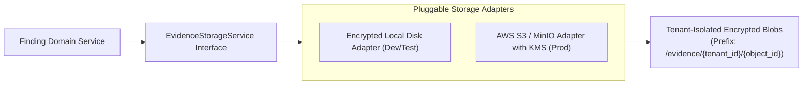

# P3-28 — Implement Secure Evidence Storage Service

**Parent Epic:** [Phase 3 — Findings Intelligence, Evidence & Reporting](../MILESTONE_PHASE_3.md)  
**Milestone:** [Phase 3 — Findings Intelligence, Evidence & Reporting](../MILESTONE_PHASE_3.md)  
**Workstream:** Workstream D — Evidence Management  
**Status:** `ready-for-dev`  

---

## 🎯 Purpose

Provide a storage abstraction for evidence that supports secure access, controlled retention, and future scalability.

---

## 📐 Architecture & Workflow Diagram

---

## 📋 Detailed Requirements

- Implement an evidence storage interface (EvidenceStorageService).
- Support the selected storage backend through an adapter (Local Encrypted Filesystem / S3 Blob Store).
- Keep storage implementation details out of finding domain logic.
- Use non-guessable object identifiers.
- Enforce tenant and evidence ownership boundaries.
- Prevent direct public access to stored evidence.
- Define encryption requirements for stored evidence (AES-256-GCM at rest).
- Support metadata persistence separately from evidence content.
- Define behavior for missing, corrupted, or unavailable objects.
- Ensure the implementation is compatible with Phase 1 data lifecycle policies.

---

## 🛡️ Security & Architectural Invariants

- **Tenant Isolation:** All finding, observation, evidence, remediation, and report records must enforce strict tenant boundaries (`tenant_id = current_tenant_id()`, ADR-0002).
- **Data Integrity & Traceability:** Individual assessment observations and evidence records must remain immutable and never be overwritten by subsequent assessments.
- **Evidence Protection:** All sensitive credentials, tokens, session cookies, and authorization headers must be redacted before presentation and export (ADR-0005).
- **Explainability:** All calculated risk scores and priority rankings must be reproducible and mathematically explainable from documented input factors.

---

## ✅ Acceptance Criteria

- [ ] Evidence is stored through a controlled abstraction.
- [ ] Finding services do not depend directly on storage-provider APIs.
- [ ] Evidence objects are not publicly accessible by default.
- [ ] Tenant access boundaries are enforced.
- [ ] Storage failure and integrity error handling are tested.

---

## 🔗 Related Documentation & Links

- Findings Domain Architecture: [`docs/architecture/FINDINGS_DOMAIN.md`](../../../docs/architecture/FINDING_SCHEMA.md)
- Evidence Retention & Redaction: [`docs/security/EVIDENCE_LIFECYCLE.md`](../../../docs/security/ACCEPTABLE_USE.md)
- Risk Scoring Specification: [`docs/architecture/RISK_SCORING_MODEL.md`](../../../docs/architecture/SCAN_PROFILES.md)
- System Architecture Baseline: [`docs/architecture/SYSTEM_ARCHITECTURE.md`](../../../docs/architecture/SYSTEM_ARCHITECTURE.md)
