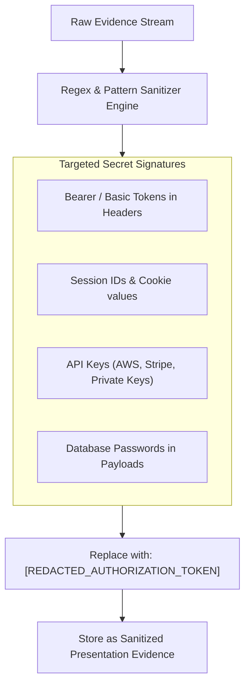

# P3-29 — Implement Evidence Redaction and Sanitization

**Parent Epic:** [Phase 3 — Findings Intelligence, Evidence & Reporting](../MILESTONE_PHASE_3.md)  
**Milestone:** [Phase 3 — Findings Intelligence, Evidence & Reporting](../MILESTONE_PHASE_3.md)  
**Workstream:** Workstream D — Evidence Management  
**Status:** `ready-for-dev`  

---

## 🎯 Purpose

Prevent sensitive information from being exposed through captured evidence, finding detail pages, or generated reports.

---

## 📐 Architecture & Workflow Diagram

---

## 📋 Detailed Requirements

- Define supported redaction patterns for sensitive values.
- Handle common sensitive HTTP headers and cookie values (Authorization, Cookie, Set-Cookie, API-Key).
- Redact credentials, authorization tokens, session identifiers, and other approved secret patterns.
- Apply redaction before evidence is made available to ordinary users.
- Preserve useful technical context where safe.
- Distinguish original protected evidence from redacted presentation evidence.
- Prevent redaction from being bypassed through report export or raw evidence retrieval.
- Record redaction rule versions.
- Define manual redaction behavior where automated detection is insufficient.

---

## 🛡️ Security & Architectural Invariants

- **Tenant Isolation:** All finding, observation, evidence, remediation, and report records must enforce strict tenant boundaries (`tenant_id = current_tenant_id()`, ADR-0002).
- **Data Integrity & Traceability:** Individual assessment observations and evidence records must remain immutable and never be overwritten by subsequent assessments.
- **Evidence Protection:** All sensitive credentials, tokens, session cookies, and authorization headers must be redacted before presentation and export (ADR-0005).
- **Explainability:** All calculated risk scores and priority rankings must be reproducible and mathematically explainable from documented input factors.

---

## ✅ Acceptance Criteria

- [ ] Sensitive values are redacted according to approved rules.
- [ ] Redaction applies consistently to UI and export paths.
- [ ] Unredacted evidence is restricted to explicitly authorized internal workflows, if retained.
- [ ] Redaction behavior is versioned and tested.
- [ ] Tests cover representative secrets and false-positive cases.

---

## 🔗 Related Documentation & Links

- Findings Domain Architecture: [`docs/architecture/FINDINGS_DOMAIN.md`](../../../docs/architecture/FINDING_SCHEMA.md)
- Evidence Retention & Redaction: [`docs/security/EVIDENCE_LIFECYCLE.md`](../../../docs/security/ACCEPTABLE_USE.md)
- Risk Scoring Specification: [`docs/architecture/RISK_SCORING_MODEL.md`](../../../docs/architecture/SCAN_PROFILES.md)
- System Architecture Baseline: [`docs/architecture/SYSTEM_ARCHITECTURE.md`](../../../docs/architecture/SYSTEM_ARCHITECTURE.md)
