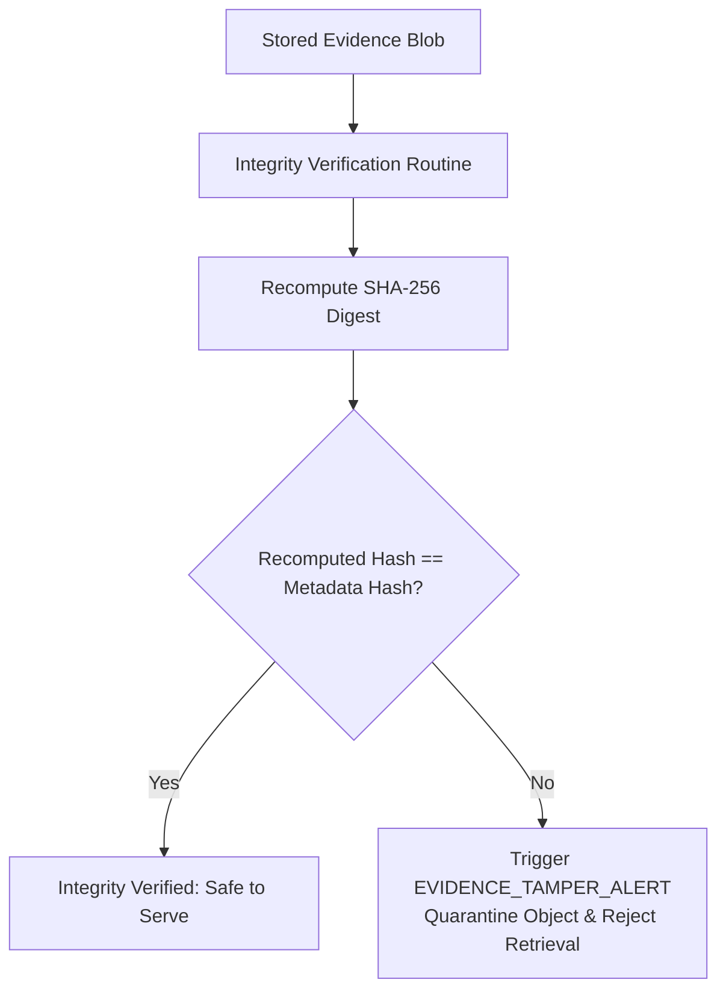

# P3-30 — Implement Evidence Integrity and Provenance Verification

**Parent Epic:** [Phase 3 — Findings Intelligence, Evidence & Reporting](../MILESTONE_PHASE_3.md)  
**Milestone:** [Phase 3 — Findings Intelligence, Evidence & Reporting](../MILESTONE_PHASE_3.md)  
**Workstream:** Workstream D — Evidence Management  
**Status:** `ready-for-dev`  

---

## 🎯 Purpose

Provide a mechanism to detect unexpected evidence modification and establish where evidence originated.

---

## 📐 Architecture & Workflow Diagram

---

## 📋 Detailed Requirements

- Generate a cryptographic digest (SHA-256) for stored evidence objects.
- Record the digest algorithm and version.
- Store evidence provenance: assessment, scanner, observation, and capture context.
- Verify integrity when evidence is retrieved or used in report generation, as appropriate.
- Detect missing or mismatched content.
- Define behavior for integrity verification failures.
- Prevent ordinary application workflows from silently changing integrity metadata.
- Ensure verification logs do not reveal sensitive evidence content.

---

## 🛡️ Security & Architectural Invariants

- **Tenant Isolation:** All finding, observation, evidence, remediation, and report records must enforce strict tenant boundaries (`tenant_id = current_tenant_id()`, ADR-0002).
- **Data Integrity & Traceability:** Individual assessment observations and evidence records must remain immutable and never be overwritten by subsequent assessments.
- **Evidence Protection:** All sensitive credentials, tokens, session cookies, and authorization headers must be redacted before presentation and export (ADR-0005).
- **Explainability:** All calculated risk scores and priority rankings must be reproducible and mathematically explainable from documented input factors.

---

## ✅ Acceptance Criteria

- [ ] Evidence integrity metadata is generated at ingestion.
- [ ] Integrity verification is available.
- [ ] Mismatches are detected and reported.
- [ ] Provenance links are preserved.
- [ ] Tests cover modification and corruption scenarios.

---

## 🔗 Related Documentation & Links

- Findings Domain Architecture: [`docs/architecture/FINDINGS_DOMAIN.md`](../../../docs/architecture/FINDING_SCHEMA.md)
- Evidence Retention & Redaction: [`docs/security/EVIDENCE_LIFECYCLE.md`](../../../docs/security/ACCEPTABLE_USE.md)
- Risk Scoring Specification: [`docs/architecture/RISK_SCORING_MODEL.md`](../../../docs/architecture/SCAN_PROFILES.md)
- System Architecture Baseline: [`docs/architecture/SYSTEM_ARCHITECTURE.md`](../../../docs/architecture/SYSTEM_ARCHITECTURE.md)
