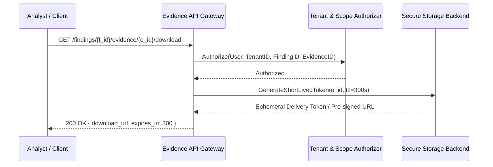

# P3-31 — Implement Authorized Evidence Retrieval and Access Controls

**Parent Epic:** [Phase 3 — Findings Intelligence, Evidence & Reporting](../MILESTONE_PHASE_3.md)  
**Milestone:** [Phase 3 — Findings Intelligence, Evidence & Reporting](../MILESTONE_PHASE_3.md)  
**Workstream:** Workstream D — Evidence Management  
**Status:** `ready-for-dev`  

---

## 🎯 Purpose

Allow authorized users to access relevant evidence while preventing unauthorized disclosure.

---

## 📐 Architecture & Workflow Diagram

---

## 📋 Detailed Requirements

- Implement evidence metadata and content retrieval operations (GET /api/v1/findings/{id}/evidence/{evidence_id}).
- Enforce tenant and finding-level authorization.
- Check permissions before issuing access to an evidence object.
- Use short-lived access mechanisms (e.g. 5-minute pre-signed URLs or streaming auth tokens).
- Prevent predictable object identifiers from enabling access.
- Avoid exposing storage-provider credentials or internal bucket paths.
- Support evidence preview or download only for approved content types.
- Set safe response headers (Content-Disposition, X-Content-Type-Options: nosniff).
- Record access decisions where required.

---

## 🛡️ Security & Architectural Invariants

- **Tenant Isolation:** All finding, observation, evidence, remediation, and report records must enforce strict tenant boundaries (`tenant_id = current_tenant_id()`, ADR-0002).
- **Data Integrity & Traceability:** Individual assessment observations and evidence records must remain immutable and never be overwritten by subsequent assessments.
- **Evidence Protection:** All sensitive credentials, tokens, session cookies, and authorization headers must be redacted before presentation and export (ADR-0005).
- **Explainability:** All calculated risk scores and priority rankings must be reproducible and mathematically explainable from documented input factors.

---

## ✅ Acceptance Criteria

- [ ] Authorized users can retrieve permitted evidence.
- [ ] Unauthorized users cannot access evidence by guessing identifiers.
- [ ] Storage credentials and internal paths remain private.
- [ ] Download and preview behavior is restricted to approved file types.
- [ ] Security tests cover cross-tenant and direct-object-access attempts.

---

## 🔗 Related Documentation & Links

- Findings Domain Architecture: [`docs/architecture/FINDINGS_DOMAIN.md`](../../../docs/architecture/FINDING_SCHEMA.md)
- Evidence Retention & Redaction: [`docs/security/EVIDENCE_LIFECYCLE.md`](../../../docs/security/ACCEPTABLE_USE.md)
- Risk Scoring Specification: [`docs/architecture/RISK_SCORING_MODEL.md`](../../../docs/architecture/SCAN_PROFILES.md)
- System Architecture Baseline: [`docs/architecture/SYSTEM_ARCHITECTURE.md`](../../../docs/architecture/SYSTEM_ARCHITECTURE.md)
