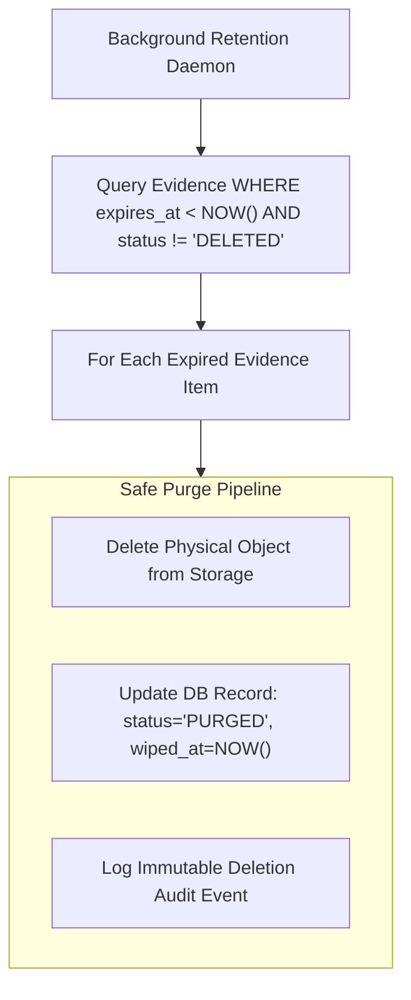

# P3-32 — Enforce Evidence Retention, Expiry and Deletion Policies

**Parent Epic:** [Phase 3 — Findings Intelligence, Evidence & Reporting](../MILESTONE_PHASE_3.md)  
**Milestone:** [Phase 3 — Findings Intelligence, Evidence & Reporting](../MILESTONE_PHASE_3.md)  
**Workstream:** Workstream D — Evidence Management  
**Status:** `ready-for-dev`  

---

## 🎯 Purpose

Implement the evidence lifecycle policies defined in Phase 1 across metadata and stored content.

---

## 📐 Architecture & Workflow Diagram

---

## 📋 Detailed Requirements

- Enforce configured retention periods (e.g. 90 days default).
- Support expiry and scheduled deletion.
- Define deletion behavior for associated metadata and storage objects.
- Ensure legal or operational retention restrictions are respected where applicable.
- Handle partial deletion failures safely.
- Record deletion outcomes without retaining the deleted sensitive content.
- Prevent expired evidence from being served.
- Define behavior when a finding remains active after evidence expiry.
- Ensure deletion operations are idempotent.

---

## 🛡️ Security & Architectural Invariants

- **Tenant Isolation:** All finding, observation, evidence, remediation, and report records must enforce strict tenant boundaries (`tenant_id = current_tenant_id()`, ADR-0002).
- **Data Integrity & Traceability:** Individual assessment observations and evidence records must remain immutable and never be overwritten by subsequent assessments.
- **Evidence Protection:** All sensitive credentials, tokens, session cookies, and authorization headers must be redacted before presentation and export (ADR-0005).
- **Explainability:** All calculated risk scores and priority rankings must be reproducible and mathematically explainable from documented input factors.

---

## ✅ Acceptance Criteria

- [ ] Evidence retention policies are enforced.
- [ ] Expired evidence cannot be retrieved through normal interfaces.
- [ ] Deletion handles storage and metadata consistently.
- [ ] Failed deletion is observable and retryable where safe.
- [ ] Tests cover expiry, deletion, and partial failure.

---

## 🔗 Related Documentation & Links

- Findings Domain Architecture: [`docs/architecture/FINDINGS_DOMAIN.md`](../../../docs/architecture/FINDING_SCHEMA.md)
- Evidence Retention & Redaction: [`docs/security/EVIDENCE_LIFECYCLE.md`](../../../docs/security/ACCEPTABLE_USE.md)
- Risk Scoring Specification: [`docs/architecture/RISK_SCORING_MODEL.md`](../../../docs/architecture/SCAN_PROFILES.md)
- System Architecture Baseline: [`docs/architecture/SYSTEM_ARCHITECTURE.md`](../../../docs/architecture/SYSTEM_ARCHITECTURE.md)
