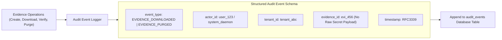

# P3-33 — Implement Evidence Access and Lifecycle Audit Events

**Parent Epic:** [Phase 3 — Findings Intelligence, Evidence & Reporting](../MILESTONE_PHASE_3.md)  
**Milestone:** [Phase 3 — Findings Intelligence, Evidence & Reporting](../MILESTONE_PHASE_3.md)  
**Workstream:** Workstream D — Evidence Management  
**Status:** `ready-for-dev`  

---

## 🎯 Purpose

Make sensitive evidence operations traceable through KELVIN's audit infrastructure.

---

## 📐 Architecture & Workflow Diagram

---

## 📋 Detailed Requirements

- Record evidence creation and association.
- Record authorized retrieval and download events where required.
- Record redaction and integrity verification outcomes.
- Record expiry and deletion events.
- Capture actor, tenant, evidence reference, action, timestamp, and outcome.
- Avoid recording evidence content or secret values in audit logs.
- Reuse the append-only audit design from Phase 1.
- Define query and access requirements for audit records.

---

## 🛡️ Security & Architectural Invariants

- **Tenant Isolation:** All finding, observation, evidence, remediation, and report records must enforce strict tenant boundaries (`tenant_id = current_tenant_id()`, ADR-0002).
- **Data Integrity & Traceability:** Individual assessment observations and evidence records must remain immutable and never be overwritten by subsequent assessments.
- **Evidence Protection:** All sensitive credentials, tokens, session cookies, and authorization headers must be redacted before presentation and export (ADR-0005).
- **Explainability:** All calculated risk scores and priority rankings must be reproducible and mathematically explainable from documented input factors.

---

## ✅ Acceptance Criteria

- [ ] Evidence lifecycle events are audited.
- [ ] Audit records contain useful references without sensitive content.
- [ ] Unauthorized access attempts are handled according to the audit policy.
- [ ] Records cannot be silently altered through normal application operations.
- [ ] Tests verify expected audit events.

---

## 🔗 Related Documentation & Links

- Findings Domain Architecture: [`docs/architecture/FINDINGS_DOMAIN.md`](../../../docs/architecture/FINDING_SCHEMA.md)
- Evidence Retention & Redaction: [`docs/security/EVIDENCE_LIFECYCLE.md`](../../../docs/security/ACCEPTABLE_USE.md)
- Risk Scoring Specification: [`docs/architecture/RISK_SCORING_MODEL.md`](../../../docs/architecture/SCAN_PROFILES.md)
- System Architecture Baseline: [`docs/architecture/SYSTEM_ARCHITECTURE.md`](../../../docs/architecture/SYSTEM_ARCHITECTURE.md)
