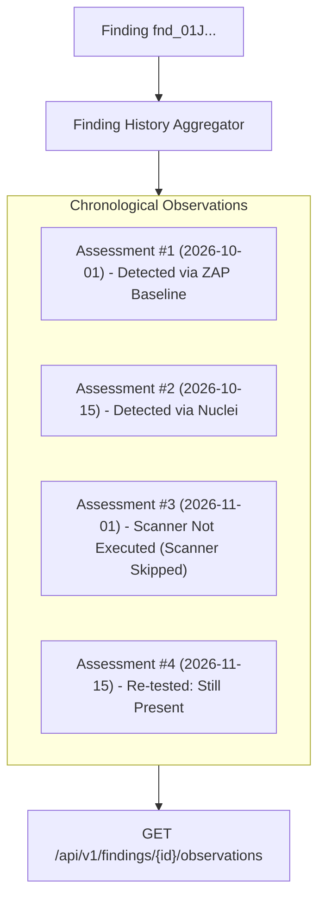

# P3-34 — Implement Assessment History and Finding Observation Timeline

**Parent Epic:** [Phase 3 — Findings Intelligence, Evidence & Reporting](../MILESTONE_PHASE_3.md)  
**Milestone:** [Phase 3 — Findings Intelligence, Evidence & Reporting](../MILESTONE_PHASE_3.md)  
**Workstream:** Workstream E — Assessment History & Remediation  
**Status:** `ready-for-dev`  

---

## 🎯 Purpose

Provide a reliable history of assessments and finding observations over time.

---

## 📐 Architecture & Workflow Diagram

---

## 📋 Detailed Requirements

- Implement an assessment history retrieval service.
- Retrieve prior observations associated with a finding.
- Show when the finding was first observed and most recently observed.
- Preserve the assessment and scanner that produced each observation.
- Distinguish a missing finding from an assessment that did not execute the relevant scanner.
- Handle partial assessments accurately.
- Apply pagination and tenant authorization.
- Avoid interpreting absence of evidence as proof that an issue was resolved.

---

## 🛡️ Security & Architectural Invariants

- **Tenant Isolation:** All finding, observation, evidence, remediation, and report records must enforce strict tenant boundaries (`tenant_id = current_tenant_id()`, ADR-0002).
- **Data Integrity & Traceability:** Individual assessment observations and evidence records must remain immutable and never be overwritten by subsequent assessments.
- **Evidence Protection:** All sensitive credentials, tokens, session cookies, and authorization headers must be redacted before presentation and export (ADR-0005).
- **Explainability:** All calculated risk scores and priority rankings must be reproducible and mathematically explainable from documented input factors.

---

## ✅ Acceptance Criteria

- [ ] Authorized users can retrieve finding observation history.
- [ ] Each observation links to its originating assessment.
- [ ] Partial and incomplete assessments are distinguishable.
- [ ] Missing observations do not automatically imply resolution.
- [ ] Tests cover repeated and partial assessments.

---

## 🔗 Related Documentation & Links

- Findings Domain Architecture: [`docs/architecture/FINDINGS_DOMAIN.md`](../../../docs/architecture/FINDING_SCHEMA.md)
- Evidence Retention & Redaction: [`docs/security/EVIDENCE_LIFECYCLE.md`](../../../docs/security/ACCEPTABLE_USE.md)
- Risk Scoring Specification: [`docs/architecture/RISK_SCORING_MODEL.md`](../../../docs/architecture/SCAN_PROFILES.md)
- System Architecture Baseline: [`docs/architecture/SYSTEM_ARCHITECTURE.md`](../../../docs/architecture/SYSTEM_ARCHITECTURE.md)
