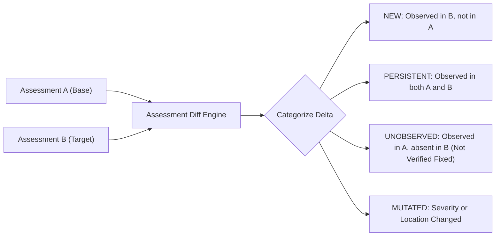

# P3-35 — Implement Assessment-to-Assessment Comparison

**Parent Epic:** [Phase 3 — Findings Intelligence, Evidence & Reporting](../MILESTONE_PHASE_3.md)  
**Milestone:** [Phase 3 — Findings Intelligence, Evidence & Reporting](../MILESTONE_PHASE_3.md)  
**Workstream:** Workstream E — Assessment History & Remediation  
**Status:** `ready-for-dev`  

---

## 🎯 Purpose

Allow users to compare two assessments of the same approved target or target scope.

---

## 📐 Architecture & Workflow Diagram

---

## 📋 Detailed Requirements

- Support selection of two compatible assessments (Base vs Target).
- Compare finding identities and observations.
- Identify: Findings newly observed, Findings observed previously but not detected, Findings observed in both, Findings with changed severity.
- Distinguish finding disappearance from verified resolution.
- Handle different scanner selections and profiles.
- Explain when comparison reliability is limited by differing scan coverage.
- Preserve the source assessment references.
- Enforce tenant authorization.

---

## 🛡️ Security & Architectural Invariants

- **Tenant Isolation:** All finding, observation, evidence, remediation, and report records must enforce strict tenant boundaries (`tenant_id = current_tenant_id()`, ADR-0002).
- **Data Integrity & Traceability:** Individual assessment observations and evidence records must remain immutable and never be overwritten by subsequent assessments.
- **Evidence Protection:** All sensitive credentials, tokens, session cookies, and authorization headers must be redacted before presentation and export (ADR-0005).
- **Explainability:** All calculated risk scores and priority rankings must be reproducible and mathematically explainable from documented input factors.

---

## ✅ Acceptance Criteria

- [ ] Compatible assessments can be compared.
- [ ] Comparison categories are documented.
- [ ] Different scanner coverage is handled transparently.
- [ ] Absence from a newer assessment is not automatically treated as resolution.
- [ ] Tests cover matching, new, missing, and partially comparable results.

---

## 🔗 Related Documentation & Links

- Findings Domain Architecture: [`docs/architecture/FINDINGS_DOMAIN.md`](../../../docs/architecture/FINDING_SCHEMA.md)
- Evidence Retention & Redaction: [`docs/security/EVIDENCE_LIFECYCLE.md`](../../../docs/security/ACCEPTABLE_USE.md)
- Risk Scoring Specification: [`docs/architecture/RISK_SCORING_MODEL.md`](../../../docs/architecture/SCAN_PROFILES.md)
- System Architecture Baseline: [`docs/architecture/SYSTEM_ARCHITECTURE.md`](../../../docs/architecture/SYSTEM_ARCHITECTURE.md)
